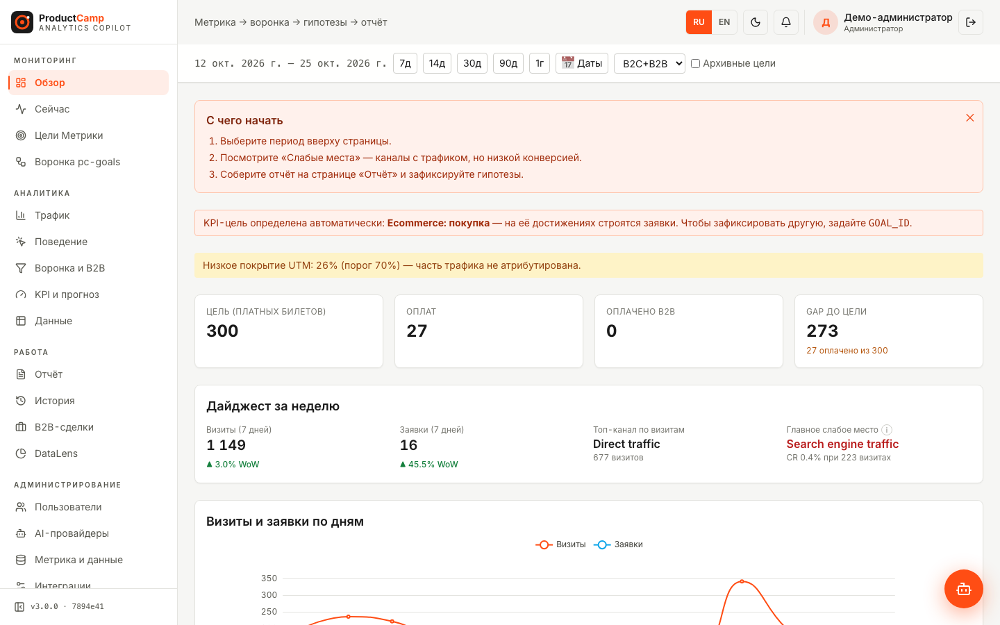

# ProductCamp Conversion Analytics

> [🇷🇺 Русский](README.md) · 🇬🇧 English

[](https://github.com/Fighter90/ai-product-copilot/actions/workflows/ci.yml)
[](https://github.com/Fighter90/ai-product-copilot/actions/workflows/e2e.yml)
[](https://github.com/Fighter90/ai-product-copilot/actions/workflows/security.yml)
[](https://github.com/Fighter90/ai-product-copilot/actions/workflows/docs-links.yml)


**Live site:** [dashboardcamp.ru](https://dashboardcamp.ru) — the landing page and help center are
public; the cabinet requires sign-in.

A multi-user analytics cabinet for ProductCamp's **"Conversions & lead-gen"** track:
Yandex Metrika → SQLite (daily history) → a web cabinet with roles and an audit log, real-time
monitoring, DOCX/PDF reports with AI analysis, Yandex DataLens export, and a RAG assistant over
the built-in help. The hypothesis methodology (Double Diamond + ICE = I × C × E) is embedded in
the report.

> **Campaign KPI:** 300+ **paid** tickets. Throughout the tool: **an application ≠ a payment**.

> ✅ **Status: working product v3.4.49.** The cabinet ships session-based authentication,
> **Administrator / Analyst** roles, and an action audit log. Real-time monitoring: Live, Goals
> (+ goal detail), Live funnel. Analytics: Traffic, Behavior, Funnel, KPI, Explore (presets),
> Report, History, B2B, DataLens. Administration: Users, AI providers (OpenRouter / Anthropic /
> YandexGPT / GigaChat — keys encrypted with AES-256-GCM), Yandex Metrika, Integrations, Audit.
> Help center + RAG assistant. RU/EN interface, dark/light theme, version in the footer.
> Ubuntu deployment: nginx + systemd + certbot ([docs/deploy.md](docs/deploy.md)).

## Live site and demo access

- **Production:** <https://dashboardcamp.ru> — the landing page (`/`), the help center (`/help`)
  and the RAG assistant are public; everything under `/app` requires signing in at `/login`.
- **Demo access** to the live site is granted by the project administrator: they create an
  account with the Analyst (or Administrator) role and hand over a one-time password via a secure
  channel. Logins and passwords are **never published** in the repository — not here, not in
  `docs/`.
- **Locally**, demo accounts are enabled with `DEMO_USERS=1`; their passwords come from your own
  `.env` (`DEMO_ADMIN_PASSWORD`, `DEMO_ANALYST_PASSWORD`). Production runs with `DEMO_USERS=0`.

## Screenshots

> Real screenshots of the production build (1440×900); the full set of 24 screens lives in
> [code/frontend/public/screenshots](code/frontend/public/screenshots).

| Landing                                | Overview: on track for 300?              | Real time                        |
| -------------------------------------- | ---------------------------------------- | -------------------------------- |
|  |  |  |

| pc-goals funnel                                    | Report                               | RAG assistant                                  |
| -------------------------------------------------- | ------------------------------------ | ---------------------------------------------- |
|  |  |  |

## Features

- **Web cabinet** — session login (HttpOnly cookie, only the token hash stored), Administrator /
  Analyst roles (RBAC enforced on the backend and in the UI), action audit log.
- **Real time** — Live feed, all counter goals with statuses, the ProductCamp event funnel
  (saw tickets → CTA → registration → cart → order) — queried directly from the Reporting API.
- **Daily analytics** — channels, UTM, geo+devices, entry/exit pages, the "visit → application →
  payment" funnel, the 300 KPI with a "What if" simulator, 11 Explore presets.
- **Backup Metrika account** — an independent daily API quota: on `429 quota_requests_by_uid` the
  client automatically retries under the backup token (sync, cli-sync and live pages); configured
  via the "Backup Metrika account" card in admin (ClientID/Secret, Verification Code → token
  exchange).
- **Resilient live screens** — on any Metrika failure (quota, outage) live pages show the latest
  available data with a banner instead of an error; live queries are capped at 31 days, full
  history lives in the database-backed sections (SQLite), quota-independent.
- **Reports** — an immutable snapshot → GOST-formatted DOCX/PDF with charts; GOST-2 front matter
  (a real TOC field, a list of figures, designations & terms, introduction, executive summary),
  bordered tables, «Рисунок N» captions, a human-readable period on the cover; AI analysis,
  AI-generated hypotheses and an AI Decision Log.
- **AI providers (4)** — OpenRouter, Anthropic, YandexGPT, GigaChat; a priority chain with
  fallback; keys encrypted with AES-256-GCM; a "Test connection" button; 30-day usage statistics.
- **Help & assistant** — a Help center (`/help`, articles from `docs/help/ru|en`) and a RAG
  assistant (bottom-right corner) that answers only from the help texts.
- **RU/EN i18n and themes** — toggles in the top bar; the choice persists in the browser and in
  the user profile; dark/light theme; product version in the footer.

### Integrations

| Integration       | What it does                                                                                                                                                                             | Where to configure                        |
| ----------------- | ---------------------------------------------------------------------------------------------------------------------------------------------------------------------------------------- | ----------------------------------------- |
| Yandex Metrika    | Stat API → SQLite (daily history, scheduled sync); Reporting API for live pages (no DB writes); Management API to create / archive / restore goals (`metrika:write`)                     | Administration → Metrika & data           |
| Yandex DataLens   | 5 CSV datasets for a Files connection; DataLens Public API connection check (Org ID, Workbook ID, IAM token); webhook receiver with a confirmation code; team dashboard links            | Administration → Integrations             |
| LLM providers (4) | OpenRouter · Anthropic · YandexGPT (AI Studio, `folderId`) · GigaChat (`scope`, TLS via the Russian Trusted Root CA) — report AI analysis, AI hypotheses, AI Decision Log, RAG assistant | Administration → AI providers             |
| Reports           | GOST-styled DOCX (`docx`) and PDF (headless Chrome); ECharts charts rendered server-side                                                                                                 | Report page; `PUPPETEER_EXECUTABLE_PATH`  |
| Notifications     | the bell in the cabinet: DataLens codes/alerts, analyst requests                                                                                                                         | automatic; audit — Administration → Audit |

## Quickstart

### One command

```bash
git clone git@github.com:Fighter90/ai-product-copilot.git
cd ai-product-copilot
./setup.sh          # install → init → start
```

### Step by step (install → init → start)

```bash
pnpm install        # 1. dependencies (pnpm workspace: backend / frontend / shared)
./init.sh           # 2. interactive .env: Metrika, AI, first admin (+ optional OAuth)
./run.sh            # 3. migrations → sync (or demo seed without a token) → cabinet
```

Open `http://localhost:5173` — landing page → `/login`. The first administrator is created on
startup from `ADMIN_EMAIL`/`ADMIN_PASSWORD` (`.env`); `DEMO_USERS=1` adds demo admin/analyst
accounts for local exploration (passwords — `DEMO_ADMIN_PASSWORD` / `DEMO_ANALYST_PASSWORD` in
your `.env`). API on `http://localhost:4000` (Swagger at `/docs`).

> Without a token and AI keys everything still runs in demo mode — handy for an instant demo.

Detailed run instructions: [docs/quickstart.md](docs/quickstart.md) and
[docs/en/runbook.md](docs/en/runbook.md); user guide — [docs/en/user-guide.md](docs/en/user-guide.md);
server deployment — [docs/deploy.md](docs/deploy.md).

## Getting a `YANDEX_OAUTH_TOKEN`

You need a token with the `metrika:read` scope. Yandex ID docs: https://yandex.ru/dev/id/doc/en/.

### Option 1 (recommended) — the built-in `pnpm auth` helper

```bash
pnpm auth        # from the repo root
```

1. The helper prints an authorize URL (`response_type=code`). Approve access in the browser.
2. Copy the **confirmation code** and paste it back into the terminal.
3. The helper exchanges the code for a token and **writes** `YANDEX_OAUTH_TOKEN` into `.env`.
   Then run `pnpm sync`.

### Option 2 (manual) — implicit flow

Open `https://oauth.yandex.ru/authorize?response_type=token&client_id=<YANDEX_CLIENT_ID>`, approve
access and paste the token from the URL fragment (`#access_token=...`) into `.env`.

Tokens and secrets live **only** in `.env` (gitignored) or encrypted in the database (admin
settings). Never commit them.

## Environment variables

Source of truth: `code/backend/src/config.ts` (Zod schema) and `.env.example`; the server `.env`
is covered in detail in [docs/deploy.md](docs/deploy.md). Values below are **defaults**, not
secrets.

**Cabinet & security**

| Variable                                        | Default                   | Purpose                                                                                     |
| ----------------------------------------------- | ------------------------- | ------------------------------------------------------------------------------------------- |
| `APP_SECRET`                                    | —                         | **required on a server**: AES-256-GCM master key for DB secrets (`openssl rand -base64 32`) |
| `ADMIN_EMAIL` / `ADMIN_PASSWORD` / `ADMIN_NAME` | `admin@productcamp.local` | bootstrap administrator, created on start while the `users` table is empty                  |
| `DEMO_USERS`                                    | `0`                       | `1` creates a demo admin and a demo analyst (local only)                                    |
| `DEMO_ADMIN_PASSWORD` / `DEMO_ANALYST_PASSWORD` | —                         | demo account passwords when `DEMO_USERS=1`                                                  |
| `PUBLIC_URL`                                    | `http://localhost:5173`   | public cabinet URL (`https://dashboardcamp.ru` in production)                               |
| `COOKIE_SECURE`                                 | `1`                       | `Secure` flag on the session cookie; `0` only for plain HTTP outside `localhost`            |
| `SESSION_DAYS`                                  | `7`                       | session lifetime, days                                                                      |
| `TRUST_PROXY`                                   | —                         | `1` trusts `X-Forwarded-For` (backend behind nginx)                                         |

**Yandex Metrika** (initial values; admins edit them in the UI, which overrides `.env`)

| Variable                                    | Default                                     | Purpose                                                                 |
| ------------------------------------------- | ------------------------------------------- | ----------------------------------------------------------------------- |
| `YANDEX_OAUTH_TOKEN`                        | —                                           | OAuth token: `metrika:read` (+ `metrika:write` for goals)               |
| `METRIKA_BACKUP_OAUTH_TOKEN`                | —                                           | backup-account token: on 429 per-UID the client falls back to its quota |
| `METRIKA_BACKUP_CLIENT_ID` / `_SECRET`      | —                                           | backup-account OAuth app (code exchange in admin)                       |
| `YANDEX_CLIENT_ID` / `YANDEX_CLIENT_SECRET` | —                                           | OAuth app used by `pnpm auth`                                           |
| `OAUTH_REDIRECT_URI`                        | `https://oauth.yandex.ru/verification_code` | OAuth app redirect URI                                                  |
| `COUNTER_ID`                                | `0`                                         | counter id; `0` = not set (demo mode works)                             |
| `GOAL_ID`                                   | `0`                                         | KPI goal; `0` = auto-detect the purchase goal on sync                   |
| `TIMEZONE`                                  | `Europe/Moscow`                             | time zone of daily aggregates                                           |
| `ARCHIVED_GOAL_ID_THRESHOLD`                | `77`                                        | goal ids below the threshold are treated as archived                    |
| `LOW_UTM_COVERAGE_RATIO`                    | `0.7`                                       | threshold of the `low_utm_coverage` flag                                |
| `INCLUDE_TEST_TRAFFIC`                      | —                                           | `1` disables excluding robots and test (`file:`) sessions in the sync   |

**AI providers** (optional seed for an empty `ai_providers` table; the UI is the main path)

| Variable                                                        | Default                                    | Purpose                                                                                                                                   |
| --------------------------------------------------------------- | ------------------------------------------ | ----------------------------------------------------------------------------------------------------------------------------------------- |
| `OPENROUTER_API_KEY` / `OPENROUTER_MODEL`                       | — / `anthropic/claude-sonnet-4.5`          | OpenRouter                                                                                                                                |
| `ANTHROPIC_API_KEY` / `ANTHROPIC_MODEL`                         | — / `claude-sonnet-4-6`                    | Anthropic                                                                                                                                 |
| `YANDEX_AI_API_KEY` / `YANDEX_AI_FOLDER_ID` / `YANDEX_AI_MODEL` | — / — / `yandexgpt/latest`                 | YandexGPT (AI Studio)                                                                                                                     |
| `GIGACHAT_AUTH_KEY` / `GIGACHAT_SCOPE` / `GIGACHAT_MODEL`       | — / `GIGACHAT_API_PERS` / `GigaChat-2-Pro` | GigaChat                                                                                                                                  |
| `NODE_EXTRA_CA_CERTS`                                           | —                                          | PEM with the Russian Trusted Root/Sub CA — without it GigaChat fails with `SELF_SIGNED_CERT_IN_CHAIN`; `deploy/deploy.sh` sets it on prod |

**Server & rendering**

| Variable                    | Default                        | Purpose                                               |
| --------------------------- | ------------------------------ | ----------------------------------------------------- |
| `API_PORT` / `PORT`         | `4000` / `5173`                | API port / frontend dev-server port                   |
| `HOST`                      | `0.0.0.0`                      | API listen address (`127.0.0.1` behind nginx in prod) |
| `DB_PATH`                   | `data/productcamp.sqlite`      | SQLite file                                           |
| `HELP_DIR`                  | `docs/help`                    | help articles (also the RAG assistant's corpus)       |
| `PUPPETEER_EXECUTABLE_PATH` | Chrome auto-detect             | Chrome/Chromium path for PDF export                   |
| `ECHARTS_PATH`              | `echarts.min.js` from frontend | ECharts UMD bundle for server-side report charts      |
| `LOG_LEVEL` / `NODE_ENV`    | `info` / —                     | pino log level / mode                                 |
| `BUILD_SHA`                 | —                              | build git SHA reported by `/api/health`               |

**Runtime settings in the DB (no `.env`).** Some parameters live only in the admin UI and are
stored in `app_settings` (secrets as ciphertext): `ORDER_GOAL_ID`, `KPI_TARGET`,
`TEST_TRAFFIC_PATTERNS`, `DATALENS_WEBHOOK_TOKEN`, `DATALENS_LINKS`, plus the DataLens Public API
connection — `DATALENS_ORG_ID`, `DATALENS_WORKBOOK_ID`, `DATALENS_IAM_TOKEN` (Administration →
Integrations → DataLens connection, "Check connection" button). `scripts/push-datalens.mjs` reads
`DATALENS_IAM_TOKEN`/`DATALENS_ORG_ID` from the process environment.

## Architecture

```
Yandex Metrika ──sync (daily chunks)──▶ SQLite ──API (Fastify, sessions/RBAC)──▶ Cabinet (React)
        │                                  │                                          │
        └── live: Reporting API directly ──┘── DataLens (CSV) · DOCX/PDF + AI · RAG assistant ──┘
```

Component, data-flow and authentication diagrams (Mermaid):
[docs/en/architecture.md](docs/en/architecture.md); data model (migrations 001..011):
[docs/en/data-model.md](docs/en/data-model.md).

## Documentation

> 📖 **GitHub Wiki** ([ai-product-copilot/wiki](https://github.com/Fighter90/ai-product-copilot/wiki)):
> Quickstart · Roles · AI providers · Metrika & goals · DataLens · Deploy · FAQ — EN + RU.
> Sources live in [docs/wiki/](docs/wiki), published via `scripts/publish-wiki.sh`.

| Document                                           | Audience               | Contents                                                      |
| -------------------------------------------------- | ---------------------- | ------------------------------------------------------------- |
| [docs/en/user-guide.md](docs/en/user-guide.md)     | analyst, administrator | v3 user guide by role and page                                |
| [docs/en/admin-guide.md](docs/en/admin-guide.md)   | administrator          | users, AI providers & keys, Metrika, DataLens, audit, backups |
| [docs/guides/](docs/guides/README.md)              | everyone               | the user guide as single DOCX and PDF files (`pnpm guides`)   |
| [docs/en/runbook.md](docs/en/runbook.md)           | developer, operations  | running, operating, troubleshooting                           |
| [docs/deploy.md](docs/deploy.md) (RU)              | operations             | Ubuntu + nginx + systemd + certbot, server `.env`             |
| [deploy/DEPLOY.md](deploy/DEPLOY.md) (RU)          | operations             | dashboardcamp.ru deployment, backups, monitoring, restore     |
| [docs/en/architecture.md](docs/en/architecture.md) | developer              | components, data flows, auth/RBAC, AI layer                   |
| [docs/en/data-model.md](docs/en/data-model.md)     | developer              | SQLite tables, columns and invariants                         |
| [docs/help/en](docs/help/en)                       | everyone               | built-in help articles (`/help`) — the RAG assistant's corpus |
| [CHANGELOG.md](CHANGELOG.md)                       | everyone               | release history (Keep a Changelog)                            |

Russian originals: [README.md](README.md), [docs/](docs/user-guide.md),
[docs/admin-guide.md](docs/admin-guide.md).

## Tech stack

Backend: Node 22 · TypeScript 5 strict · Fastify 5 (tsx) · Zod · better-sqlite3 · undici ·
`docx` · puppeteer-core · pino.
Frontend: React 18 · Vite · TailwindCSS · Apache ECharts · TanStack Table/Query · Zustand ·
react-router · ru/en i18n.
Tooling: pnpm 9 · Vitest · Playwright · ESLint + Prettier · GitHub Actions · nginx/systemd for
deployment.

Adding a dependency outside this list requires an ADR in `docs/decisions/`.

## Roles

|                                             | Analyst | Administrator |
| ------------------------------------------- | :-----: | :-----------: |
| Overview, Live, Goals, Live funnel          |   ✅    |      ✅       |
| Traffic, Behavior, Funnel, KPI, Explore     |   ✅    |      ✅       |
| Report, History, B2B, DataLens              |   ✅    |      ✅       |
| Help center, RAG assistant, RU/EN, themes   |   ✅    |      ✅       |
| Users (create, roles, password reset)       |    —    |      ✅       |
| AI providers (keys, models, priorities)     |    —    |      ✅       |
| Yandex Metrika settings, synchronization    |    —    |      ✅       |
| Integrations (DataLens API, webhook), audit |    —    |      ✅       |
| Metrika goal management (API)               |    —    |      ✅       |

Permissions are enforced on the backend (`/api/admin/**`, settings mutations — admin only); all
significant actions are written to `audit_log`.

## AI providers

Administrators configure providers under "Administration → AI providers":

| Provider   | Secret            | Extras     | Example model                 |
| ---------- | ----------------- | ---------- | ----------------------------- |
| OpenRouter | API key           | —          | `anthropic/claude-sonnet-4.5` |
| Anthropic  | API key           | —          | `claude-sonnet-4-6`           |
| YandexGPT  | AI Studio API key | `folderId` | `yandexgpt/latest`            |
| GigaChat   | Authorization Key | `scope`    | `GigaChat-2-Pro`              |

Enabled providers form a **priority chain**: a failure or timeout falls over to the next one.
Keys are encrypted with AES-256-GCM (master key `APP_SECRET`) and stored only as ciphertext.
AI consumers: the report (analysis / hypotheses / Decision Log) and the help assistant. Keys in
`.env` are an optional first-time seed only.

## Language and themes

- **RU/EN toggle** in the cabinet top bar; the language persists in the browser and in the user
  profile (`PATCH /api/auth/me`); help articles and assistant answers follow the UI language.
- **Dark/light theme** toggle; applied before first paint (no flashing).
- **Version in the footer** — from the root `package.json` + the build's git SHA.

## Project structure

```
.
├── code/
│   ├── backend/    # Fastify API: auth/RBAC, settings, AI providers, live, help, DataLens,
│   │               #   Metrika client, SQLite (migrations 001..011), DOCX/PDF reports
│   ├── frontend/   # React+Vite cabinet: public/app/admin pages, i18n, themes, assistant
│   └── shared/     # shared types and constants (@pca/shared)
├── deploy/         # server configs (nginx, systemd) — see docs/deploy.md
├── docs/           # architecture, data-model, deploy, user-guide (ru/en), runbook, help/ru|en,
│                   #   decisions/ (ADRs), specs/
├── e2e/            # Playwright
├── QA/             # testing prompts
├── data/           # SQLite + reports (gitignored)
└── setup.sh / init.sh / run.sh   # one-command local run
```

Full guide: [docs/project-structure.md](docs/project-structure.md).

## CLI commands

| Command                                            | Description                                            |
| -------------------------------------------------- | ------------------------------------------------------ |
| `./setup.sh`                                       | everything in one command: install → init → start      |
| `./init.sh`                                        | init `.env` (Metrika, AI, first admin, optional OAuth) |
| `./run.sh`                                         | start: migrations → sync/seed → cabinet                |
| `pnpm auth`                                        | Yandex Metrika OAuth → `YANDEX_OAUTH_TOKEN` in `.env`  |
| `pnpm seed`                                        | seed the DB with demo data (no token)                  |
| `npm run sync` (`pnpm --filter @pca/backend sync`) | live pull from Metrika for a period                    |
| `pnpm dev`                                         | backend (tsx watch) + frontend (vite)                  |
| `pnpm build` / `pnpm typecheck`                    | build / type checking                                  |
| `pnpm lint` / `pnpm format:check`                  | lint / format check                                    |
| `pnpm test` / `pnpm coverage`                      | vitest / coverage                                      |
| `pnpm e2e`                                         | Playwright                                             |

## Methodology (Double Diamond)

- **Hypothesis format:** "{subject} {action} {solution}, if {condition}".
- **≥3 hidden assumptions** across behavior / market / tech; **≥2 validation methods**.
- **ICE = I × C × E (product, 1–1000)** — `docs/decisions/005-ice-product-vs-mean.md`.
- **Traffic light** (🟢/🟡/🔴) + a verification deadline; the **Decision Log** closes the loop.

Methodology: `docs/methodology-hypotheses.md`; AI hypotheses and the AI Decision Log are generated
inside the report.

## Server deployment

Ubuntu + nginx + systemd + certbot: step-by-step instructions, the systemd unit and the nginx
config — in [docs/deploy.md](docs/deploy.md); configs live in `deploy/`. Production requirements:
`APP_SECRET` (master key encrypting DB secrets) and `COOKIE_SECURE=1` behind HTTPS.

## CI/CD

- **ci.yml** — `lint → format:check → typecheck → coverage → build` + actionlint + gate;
- **e2e.yml** — Playwright (cabinet smoke);
- **security.yml** — gitleaks + `pnpm audit` (high+);
- **review.yml** — AI code review (when `ANTHROPIC_API_KEY` is set in repo secrets);
- **pr-lint.yml** — Conventional PR title;
- **release.yml** — on a `v*.*.*` tag: verify → package → GitHub Release.

## Spec-Driven Development

Non-trivial features go through a spec before code: `docs/specs/NNN-*.md` (cycle: spec → review →
plan → tests → impl). Registry: `docs/specs/README.md`.

## Known limitations

- B2B is manual entry (`b2b_manual`); Metrika does not cover the B2B pipeline.
- UTM tagging is uneven: segments with < 70% coverage are flagged `low_utm_coverage`.
- `ym:s:exitURL` is not supported by the Stat API → the "Exit pages" table is empty on live data.
- PDF needs Chrome (`PUPPETEER_EXECUTABLE_PATH`); DOCX needs nothing extra.
- Live pages depend on Reporting API availability and are not cached.

## Releases

Full history: [CHANGELOG.md](CHANGELOG.md). Recent:

| Version             | Date       | Description                                                                                                                                                                                                                                                         |
| ------------------- | ---------- | ------------------------------------------------------------------------------------------------------------------------------------------------------------------------------------------------------------------------------------------------------------------- |
| **v3.4.1** (Latest) | 2026-11-05 | Live pages survive any Metrika failure (stale cache + human-readable 503s), root cause of "Bad Request" eliminated (31-day live clamp); final per-key verification — OVERALL PASS on 556 days × 4 tables                                                            |
| v3.4.0              | 2026-11-05 | Backup Metrika account (ANA-107), quota fallback in every path, 22/22 bug-report verified, CSP fonts, perf, ≤31-day range requests                                                                                                                                  |
| v3.3.1              | 2026-10-29 | REG-01..12: demo access, 400 instead of 500, "paid"-boundaries, period coverage, sync statuses, snapshots, security                                                                                                                                                 |
| v3.3.0              | 2026-10-28 | 30-minute sync, "stats" import (marketing), help center, duplicate goals                                                                                                                                                                                            |
| v3.2.0              | 2026-10-27 | See [CHANGELOG.md](CHANGELOG.md)                                                                                                                                                                                                                                    |
| v3.1.0              | 2026-10-26 | Help center ×2.5 RU/EN with production screenshots; GOST-2 reports (TOC, list of figures, bordered tables); see [CHANGELOG.md](CHANGELOG.md)                                                                                                                        |
| v3.0.0              | 2026-10-25 | Web cabinet: sessions, roles (admin/analyst), audit; Live/Goals/Live funnel; administration (Users, 4 AI providers, Metrika, Integrations, Audit); DataLens (CSV + webhook); RAG assistant and Help center; RU/EN i18n and themes; nginx/systemd/certbot deployment |
| v2.10.0             | 2026-05-29 | `./init.sh` collects Yandex OAuth ClientID/secret                                                                                                                                                                                                                   |
| v2.9.5              | 2026-05-29 | ICE in AI analysis is a product (I×C×E), not a mean                                                                                                                                                                                                                 |

## License · Authors · Credits

- Authors: the ProductCamp "Conversions & lead-gen" track team.
