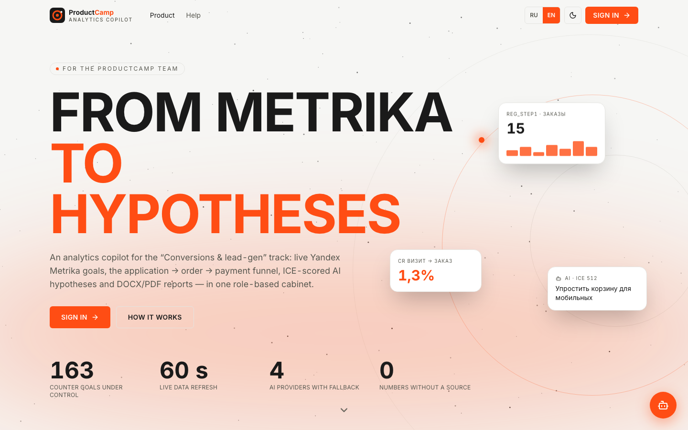
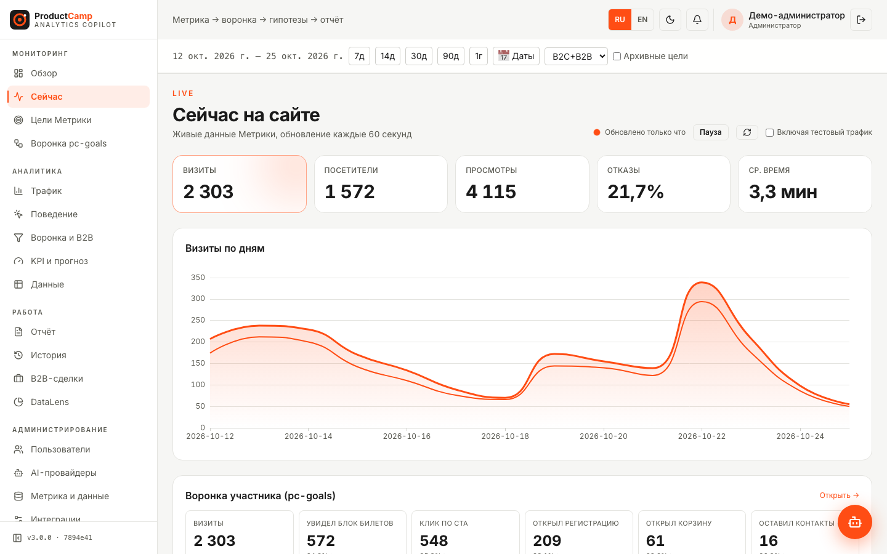
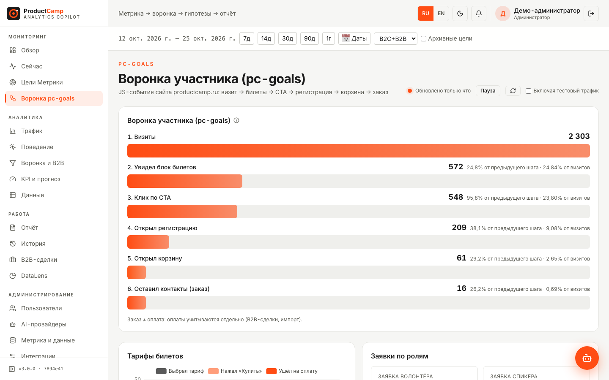
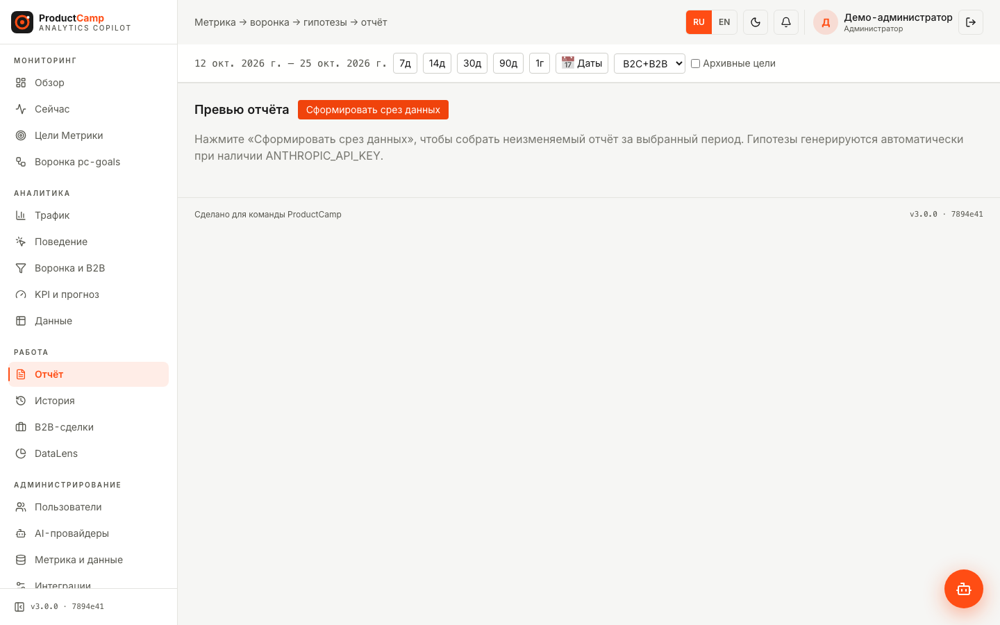
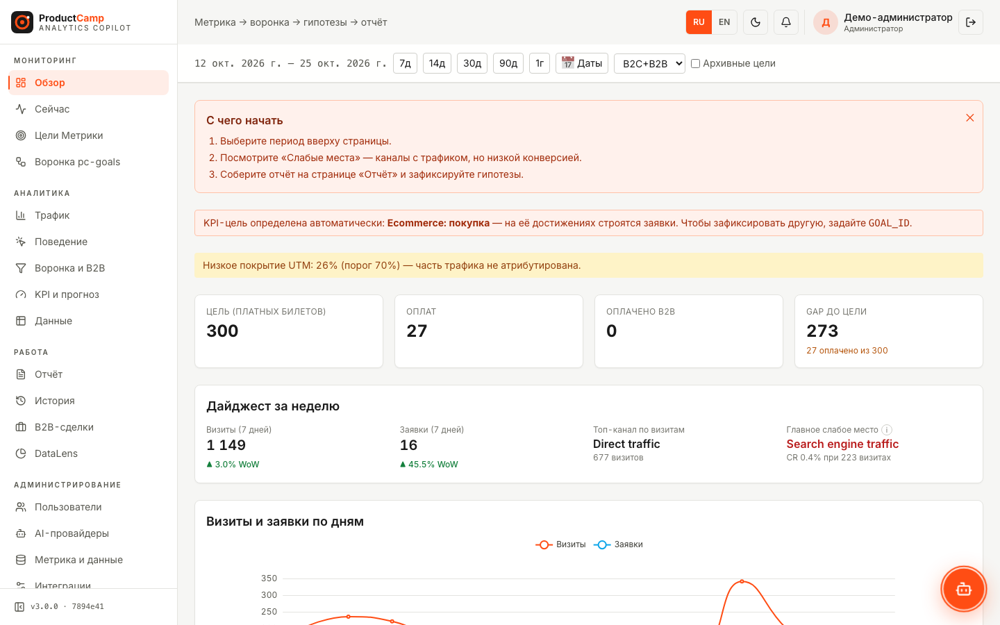

# ProductCamp Conversion Analytics

[](https://github.com/Fighter90/ai-product-copilot/actions/workflows/ci.yml)

> [🇷🇺 Русский](README.md) · 🇬🇧 English


A multi-user analytics cabinet for ProductCamp's **"Conversions & lead-gen"** track:
Yandex Metrika → SQLite (daily history) → a web cabinet with roles and an audit log, real-time
monitoring, DOCX/PDF reports with AI analysis, Yandex DataLens export, and a RAG assistant over
the built-in help. The hypothesis methodology (Double Diamond + ICE = I × C × E) is embedded in
the report.

> **Campaign KPI:** 300+ **paid** tickets. Throughout the tool: **an application ≠ a payment**.

> ✅ **Status: working product v3.1.0.** The cabinet ships session-based authentication,
> **Administrator / Analyst** roles, and an action audit log. Real-time monitoring: Live, Goals
> (+ goal detail), Live funnel. Analytics: Traffic, Behavior, Funnel, KPI, Explore (presets),
> Report, History, B2B, DataLens. Administration: Users, AI providers (OpenRouter / Anthropic /
> YandexGPT / GigaChat — keys encrypted with AES-256-GCM), Yandex Metrika, Integrations, Audit.
> Help center + RAG assistant. RU/EN interface, dark/light theme, version in the footer.
> Ubuntu deployment: nginx + systemd + certbot ([docs/deploy.md](docs/deploy.md)).

## Screenshots

> Real screenshots of the production build (1440×900); the full set of 24 screens lives in
> [code/frontend/public/screenshots](code/frontend/public/screenshots).

| Landing                                | Overview: on track for 300?              | Real time                        |
| -------------------------------------- | ---------------------------------------- | -------------------------------- |
|  |  |  |

| pc-goals funnel                                    | Report                               | RAG assistant                                  |
| -------------------------------------------------- | ------------------------------------ | ---------------------------------------------- |
|  |  |  |

## Features

- **Web cabinet** — session login (HttpOnly cookie, only the token hash stored), Administrator /
  Analyst roles (RBAC enforced on the backend and in the UI), action audit log.
- **Real time** — Live feed, all counter goals with statuses, the ProductCamp event funnel
  (saw tickets → CTA → registration → cart → order) — queried directly from the Reporting API.
- **Daily analytics** — channels, UTM, geo+devices, entry/exit pages, the "visit → application →
  payment" funnel, the 300 KPI with a "What if" simulator, 11 Explore presets.
- **Reports** — an immutable snapshot → GOST-formatted DOCX/PDF with charts; AI analysis,
  AI-generated hypotheses and an AI Decision Log.
- **AI providers** — OpenRouter, Anthropic, YandexGPT, GigaChat; a priority chain with fallback;
  keys encrypted with AES-256-GCM; per-call usage statistics.
- **DataLens** — 5 ready-made CSV datasets (Files connection) + a token-protected webhook
  receiver; in-app notifications.
- **Help & assistant** — a Help center (`/help`, articles from `docs/help/ru|en`) and a RAG
  assistant (bottom-right corner) that answers only from the help texts.
- **RU/EN i18n and themes** — toggles in the top bar; the choice persists in the browser and in
  the user profile; dark/light theme; product version in the footer.

## Quickstart

### One command

```bash
git clone git@github.com:Fighter90/yandex-metrika-analyse-dashboard.git
cd yandex-metrika-analyse-dashboard
./setup.sh          # install → init → start
```

### Step by step (install → init → start)

```bash
pnpm install        # 1. dependencies (pnpm workspace: backend / frontend / shared)
./init.sh           # 2. interactive .env: Metrika, AI, first admin (+ optional OAuth)
./run.sh            # 3. migrations → sync (or demo seed without a token) → cabinet
```

Open `http://localhost:5173` — landing page → `/login`. The first administrator is created on
startup from `ADMIN_EMAIL`/`ADMIN_PASSWORD` (`.env`); `DEMO_USERS=1` adds demo admin/analyst
accounts for local exploration. API on `http://localhost:4000` (Swagger at `/docs`).

> Without a token and AI keys everything still runs in demo mode — handy for an instant demo.

Detailed run instructions: [docs/quickstart.md](docs/quickstart.md) and
[docs/en/runbook.md](docs/en/runbook.md); user guide — [docs/en/user-guide.md](docs/en/user-guide.md);
server deployment — [docs/deploy.md](docs/deploy.md).

## Getting a `YANDEX_OAUTH_TOKEN`

You need a token with the `metrika:read` scope. Yandex ID docs: https://yandex.ru/dev/id/doc/en/.

### Option 1 (recommended) — the built-in `pnpm auth` helper

```bash
pnpm auth        # from the repo root
```

1. The helper prints an authorize URL (`response_type=code`). Approve access in the browser.
2. Copy the **confirmation code** and paste it back into the terminal.
3. The helper exchanges the code for a token and **writes** `YANDEX_OAUTH_TOKEN` into `.env`.
   Then run `pnpm sync`.

### Option 2 (manual) — implicit flow

Open `https://oauth.yandex.ru/authorize?response_type=token&client_id=<YANDEX_CLIENT_ID>`, approve
access and paste the token from the URL fragment (`#access_token=...`) into `.env`.

Tokens and secrets live **only** in `.env` (gitignored) or encrypted in the database (admin
settings). Never commit them.

## Architecture

```
Yandex Metrika ──sync (daily chunks)──▶ SQLite ──API (Fastify, sessions/RBAC)──▶ Cabinet (React)
        │                                  │                                          │
        └── live: Reporting API directly ──┘── DataLens (CSV) · DOCX/PDF + AI · RAG assistant ──┘
```

Component, data-flow and authentication diagrams (Mermaid): [docs/architecture.md](docs/architecture.md);
data model (migrations 001..010): [docs/data-model.md](docs/data-model.md).

## Tech stack

Backend: Node 20 · TypeScript 5 strict · Fastify 4 (tsx) · Zod · better-sqlite3 · undici ·
`docx` · puppeteer-core · pino.
Frontend: React 18 · Vite · TailwindCSS · Apache ECharts · TanStack Table/Query · Zustand ·
react-router · ru/en i18n.
Tooling: pnpm 9 · Vitest · Playwright · ESLint + Prettier · GitHub Actions · nginx/systemd for
deployment.

Adding a dependency outside this list requires an ADR in `docs/decisions/`.

## Roles

|                                           | Analyst | Administrator |
| ----------------------------------------- | :-----: | :-----------: |
| Overview, Live, Goals, Live funnel        |   ✅    |      ✅       |
| Traffic, Behavior, Funnel, KPI, Explore   |   ✅    |      ✅       |
| Report, History, B2B, DataLens            |   ✅    |      ✅       |
| Help center, RAG assistant, RU/EN, themes |   ✅    |      ✅       |
| Users (create, roles, password reset)     |    —    |      ✅       |
| AI providers (keys, models, priorities)   |    —    |      ✅       |
| Yandex Metrika settings, synchronization  |    —    |      ✅       |
| Integrations (DataLens webhook) and audit |    —    |      ✅       |

Permissions are enforced on the backend (`/api/admin/**`, settings mutations — admin only); all
significant actions are written to `audit_log`.

## AI providers

Administrators configure providers under "Administration → AI providers":

| Provider   | Secret            | Extras     | Example model                 |
| ---------- | ----------------- | ---------- | ----------------------------- |
| OpenRouter | API key           | —          | `anthropic/claude-sonnet-4.5` |
| Anthropic  | API key           | —          | `claude-sonnet-4-6`           |
| YandexGPT  | AI Studio API key | `folderId` | `yandexgpt/latest`            |
| GigaChat   | Authorization Key | `scope`    | `GigaChat-2-Pro`              |

Enabled providers form a **priority chain**: a failure or timeout falls over to the next one.
Keys are encrypted with AES-256-GCM (master key `APP_SECRET`) and stored only as ciphertext.
AI consumers: the report (analysis / hypotheses / Decision Log) and the help assistant. Keys in
`.env` are an optional first-time seed only.

## Language and themes

- **RU/EN toggle** in the cabinet top bar; the language persists in the browser and in the user
  profile (`PATCH /api/auth/me`); help articles and assistant answers follow the UI language.
- **Dark/light theme** toggle; applied before first paint (no flashing).
- **Version in the footer** — from the root `package.json` + the build's git SHA.

## Project structure

```
.
├── code/
│   ├── backend/    # Fastify API: auth/RBAC, settings, AI providers, live, help, DataLens,
│   │               #   Metrika client, SQLite (migrations 001..010), DOCX/PDF reports
│   ├── frontend/   # React+Vite cabinet: public/app/admin pages, i18n, themes, assistant
│   └── shared/     # shared types and constants (@pca/shared)
├── deploy/         # server configs (nginx, systemd) — see docs/deploy.md
├── docs/           # architecture, data-model, deploy, user-guide (ru/en), runbook, help/ru|en,
│                   #   decisions/ (ADRs), specs/
├── e2e/            # Playwright
├── QA/             # testing prompts
├── data/           # SQLite + reports (gitignored)
└── setup.sh / init.sh / run.sh   # one-command local run
```

Full guide: [docs/project-structure.md](docs/project-structure.md).

## CLI commands

| Command                                            | Description                                            |
| -------------------------------------------------- | ------------------------------------------------------ |
| `./setup.sh`                                       | everything in one command: install → init → start      |
| `./init.sh`                                        | init `.env` (Metrika, AI, first admin, optional OAuth) |
| `./run.sh`                                         | start: migrations → sync/seed → cabinet                |
| `pnpm auth`                                        | Yandex Metrika OAuth → `YANDEX_OAUTH_TOKEN` in `.env`  |
| `pnpm seed`                                        | seed the DB with demo data (no token)                  |
| `npm run sync` (`pnpm --filter @pca/backend sync`) | live pull from Metrika for a period                    |
| `pnpm dev`                                         | backend (tsx watch) + frontend (vite)                  |
| `pnpm build` / `pnpm typecheck`                    | build / type checking                                  |
| `pnpm lint` / `pnpm format:check`                  | lint / format check                                    |
| `pnpm test` / `pnpm coverage`                      | vitest / coverage                                      |
| `pnpm e2e`                                         | Playwright                                             |

## Methodology (Double Diamond)

- **Hypothesis format:** "{subject} {action} {solution}, if {condition}".
- **≥3 hidden assumptions** across behavior / market / tech; **≥2 validation methods**.
- **ICE = I × C × E (product, 1–1000)** — `docs/decisions/005-ice-product-vs-mean.md`.
- **Traffic light** (🟢/🟡/🔴) + a verification deadline; the **Decision Log** closes the loop.

Methodology: `docs/methodology-hypotheses.md`; AI hypotheses and the AI Decision Log are generated
inside the report.

## Server deployment

Ubuntu + nginx + systemd + certbot: step-by-step instructions, the systemd unit and the nginx
config — in [docs/deploy.md](docs/deploy.md); configs live in `deploy/`. Production requirements:
`APP_SECRET` (master key encrypting DB secrets) and `COOKIE_SECURE=1` behind HTTPS.

## CI/CD

- **ci.yml** — `lint → format:check → typecheck → coverage → build` + actionlint + gate;
- **e2e.yml** — Playwright (cabinet smoke);
- **security.yml** — gitleaks + `pnpm audit` (high+);
- **review.yml** — AI code review (when `ANTHROPIC_API_KEY` is set in repo secrets);
- **pr-lint.yml** — Conventional PR title;
- **release.yml** — on a `v*.*.*` tag: verify → package → GitHub Release.

## Spec-Driven Development

Non-trivial features go through a spec before code: `docs/specs/NNN-*.md` (cycle: spec → review →
plan → tests → impl). Registry: `docs/specs/README.md`.

## Known limitations

- B2B is manual entry (`b2b_manual`); Metrika does not cover the B2B pipeline.
- UTM tagging is uneven: segments with < 70% coverage are flagged `low_utm_coverage`.
- `ym:s:exitURL` is not supported by the Stat API → the "Exit pages" table is empty on live data.
- PDF needs Chrome (`PUPPETEER_EXECUTABLE_PATH`); DOCX needs nothing extra.
- Live pages depend on Reporting API availability and are not cached.

## Releases

Full history: [CHANGELOG.md](CHANGELOG.md). Recent:

| Version             | Date       | Description                                                                                                                                                                                                                                                         |
| ------------------- | ---------- | ------------------------------------------------------------------------------------------------------------------------------------------------------------------------------------------------------------------------------------------------------------------- |
| **v3.0.0** (Latest) | 2026-10-25 | Web cabinet: sessions, roles (admin/analyst), audit; Live/Goals/Live funnel; administration (Users, 4 AI providers, Metrika, Integrations, Audit); DataLens (CSV + webhook); RAG assistant and Help center; RU/EN i18n and themes; nginx/systemd/certbot deployment |
| v2.10.0             | 2026-05-29 | `./init.sh` collects Yandex OAuth ClientID/secret                                                                                                                                                                                                                   |
| v2.9.5              | 2026-05-29 | ICE in AI analysis is a product (I×C×E), not a mean                                                                                                                                                                                                                 |

## License · Authors · Credits

- Authors: the ProductCamp "Conversions & lead-gen" track team.
