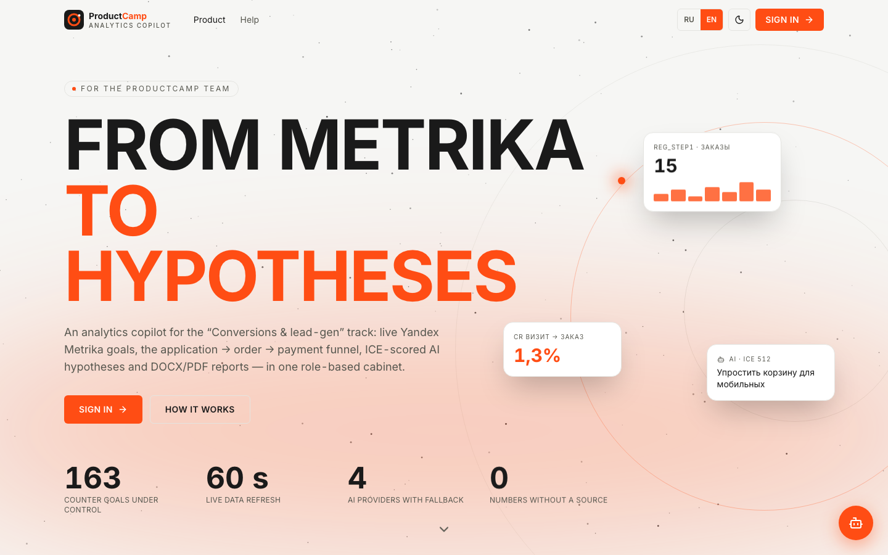
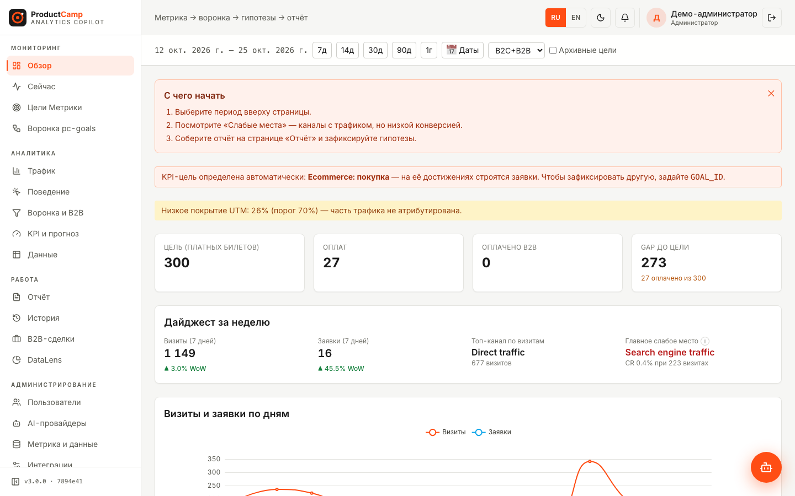
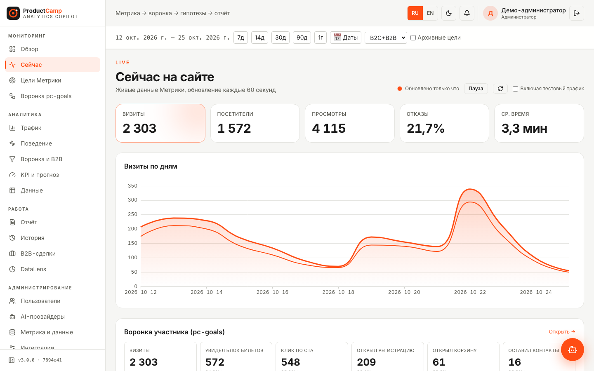
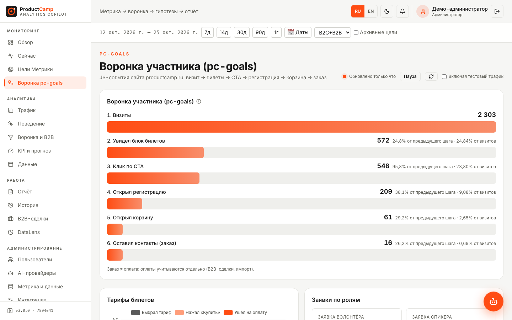
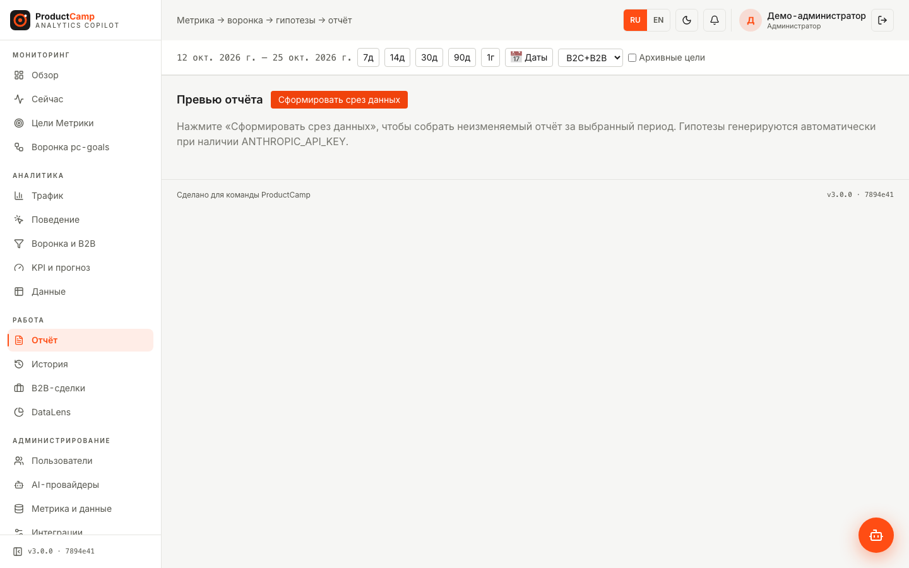

# ProductCamp Conversion Analytics

[](https://github.com/Fighter90/ai-product-copilot/actions/workflows/ci.yml)

> 🇷🇺 Русский · [🇬🇧 English](README.en.md)


Многопользовательский аналитический кабинет трека **«Конверсии и лидген» ProductCamp**:
Яндекс.Метрика → SQLite (история по дням) → личный кабинет с ролями и аудитом, мониторинг
реального времени, отчёты DOCX/PDF с AI-анализом, экспорт в Яндекс DataLens, RAG-ассистент
по справке. Методология гипотез (Double Diamond + ICE = I × C × E) встроена в отчёт.

> **KPI кампании:** 300+ **платных** билетов. Везде в инструменте: **заявка ≠ оплата**.

> ✅ **Статус: рабочий продукт v3.1.0.** Личный кабинет: аутентификация по сессиям, роли
> **Администратор / Аналитик**, журнал действий (аудит). Мониторинг реального времени: Live,
> Цели (+деталь цели), Воронка live. Аналитика: Трафик, Поведение, Воронка, KPI, Исследуй
> (пресеты), Отчёт, История, B2B, DataLens. Админка: Пользователи, AI-провайдеры
> (OpenRouter/Anthropic/YandexGPT/GigaChat — ключи шифруются AES-256-GCM), Яндекс.Метрика,
> Интеграции, Аудит. Справка + RAG-ассистент. Интерфейс ru/en, тёмная/светлая тема, версия
> в футере. Деплой на Ubuntu: nginx + systemd + certbot ([docs/deploy.md](docs/deploy.md)).

## Скриншоты

> Реальные скриншоты прод-версии (1440×900); полный набор из 24 экранов — в
> [code/frontend/public/screenshots](code/frontend/public/screenshots).

| Лендинг                                | Обзор: успеваем к 300?                | Реальное время                   |
| -------------------------------------- | ------------------------------------- | -------------------------------- |
|  |  |  |

| Воронка pc-goals                                    | Отчёт                               | RAG-ассистент                                  |
| --------------------------------------------------- | ----------------------------------- | ---------------------------------------------- |
|  |  |  |

## Возможности

- **Личный кабинет** — вход по сессиям (cookie HttpOnly, хэш токена в БД), роли
  Администратор/Аналитик (RBAC на бэкенде и в UI), журнал действий (аудит).
- **Реальное время** — Live-лента, все цели счётчика со статусами, воронка PC-событий
  (просмотр билетов → CTA → регистрация → корзина → заказ) — напрямую через Reporting API.
- **Аналитика по дням** — каналы, UTM, гео+устройства, страницы входа/выхода, воронка
  «визит → заявка → оплата», KPI 300 с «Что если»-симулятором, пресеты «Исследуй» (11 срезов).
- **Отчёты** — неизменяемый снапшот → DOCX/PDF по ГОСТ с графиками; AI-анализ, AI-гипотезы
  и AI Decision Log.
- **AI-провайдеры** — OpenRouter, Anthropic, YandexGPT, GigaChat; цепочка по приоритету с
  фоллбэком; ключи шифруются AES-256-GCM; статистика вызовов.
- **DataLens** — 5 готовых CSV-датасетов (Files-подключение) + webhook-приёмник с кодом
  подтверждения; уведомления в кабинете.
- **Справка и ассистент** — раздел `/help` (статьи из `docs/help/ru|en`) и RAG-ассистент
  (правый нижний угол), отвечающий только по текстам справки.
- **i18n ru/en и темы** — переключатели в шапке; выбор сохраняется в браузере и профиле;
  тёмная/светлая тема; версия продукта в футере.

## Quickstart

### Одной командой

```bash
git clone git@github.com:Fighter90/yandex-metrika-analyse-dashboard.git
cd yandex-metrika-analyse-dashboard
./setup.sh          # install → init → start
```

### По шагам (install → init → start)

```bash
pnpm install        # 1. зависимости (pnpm workspace: backend / frontend / shared)
./init.sh           # 2. интерактивный .env: Метрика, AI, первый админ (+ опц. OAuth)
./run.sh            # 3. миграции → sync (или демо-seed без токена) → кабинет
```

Откроется `http://localhost:5173` — лендинг → `/login`. Первый администратор создаётся при старте
из `ADMIN_EMAIL`/`ADMIN_PASSWORD` (`.env`); `DEMO_USERS=1` добавляет демо-админа и демо-аналитика
для локального просмотра. API — `http://localhost:4000` (Swagger — `/docs`).

> Без токена и без AI-ключей всё работает в демо-режиме — удобно показать инструмент сразу.

Подробный разбор запуска — в [docs/quickstart.md](docs/quickstart.md) и
[docs/runbook.md](docs/runbook.md); руководство пользователя —
[docs/user-guide.md](docs/user-guide.md); деплой на сервер — [docs/deploy.md](docs/deploy.md).

## Как получить `YANDEX_OAUTH_TOKEN`

Нужен токен со scope `metrika:read`. Документация Яндекс ID: https://yandex.ru/dev/id/doc/ru/.

### Способ 1 (рекомендуется) — встроенный помощник `pnpm auth`

```bash
pnpm auth        # из корня репозитория
```

1. Помощник печатает ссылку авторизации (`response_type=code`). Подтвердите доступ в браузере.
2. Скопируйте **код подтверждения** и вставьте обратно в терминал.
3. Помощник обменяет код на токен и **сам впишет** `YANDEX_OAUTH_TOKEN` в `.env`. Дальше: `pnpm sync`.

### Способ 2 (вручную) — implicit flow

Откройте `https://oauth.yandex.ru/authorize?response_type=token&client_id=<YANDEX_CLIENT_ID>`,
подтвердите доступ и скопируйте токен из адресной строки (`#access_token=...`) в `.env`.

Токен и секреты хранятся **только** в `.env` (в `.gitignore`) либо в зашифрованном виде в БД
(настройки админа). Никогда не коммитьте их.

## Архитектура

```
Яндекс.Метрика ──sync (дневные чанки)──▶ SQLite ──API (Fastify, сессии/RBAC)──▶ Кабинет (React)
        │                                  │                                        │
        └── live: Reporting API напрямую ──┘── DataLens (CSV) · DOCX/PDF + AI · RAG-ассистент ──┘
```

Схемы компонентов, потоков данных и аутентификации (Mermaid) —
[docs/architecture.md](docs/architecture.md); модель БД (миграции 001..010) —
[docs/data-model.md](docs/data-model.md).

## Технологический стек

Backend: Node 20 · TypeScript 5 strict · Fastify 4 (tsx) · Zod · better-sqlite3 · undici ·
`docx` · puppeteer-core · pino.
Frontend: React 18 · Vite · TailwindCSS · Apache ECharts · TanStack Table/Query · Zustand ·
react-router · i18n ru/en.
Инфраструктура: pnpm 9 · Vitest · Playwright · ESLint + Prettier · GitHub Actions · nginx/systemd
на деплое.

Добавление зависимостей вне списка требует ADR в `docs/decisions/`.

## Роли

|                                             | Аналитик | Администратор |
| ------------------------------------------- | :------: | :-----------: |
| Обзор, Live, Цели, Воронка live             |    ✅    |      ✅       |
| Трафик, Поведение, Воронка, KPI, Исследуй   |    ✅    |      ✅       |
| Отчёт, История, B2B, DataLens               |    ✅    |      ✅       |
| Справка, RAG-ассистент, ru/en, темы         |    ✅    |      ✅       |
| Пользователи (создание, роли, сброс пароля) |    —     |      ✅       |
| AI-провайдеры (ключи, модели, приоритеты)   |    —     |      ✅       |
| Настройки Яндекс.Метрики, синхронизация     |    —     |      ✅       |
| Интеграции (webhook DataLens) и аудит       |    —     |      ✅       |

Права проверяются на бэкенде (`/api/admin/**`, мутации настроек — только admin); все значимые
действия пишутся в `audit_log`.

## AI-провайдеры

Администратор настраивает провайдеров в «Администрирование → AI-провайдеры»:

| Провайдер  | Ключ                 | Доп. поля  | Пример модели                 |
| ---------- | -------------------- | ---------- | ----------------------------- |
| OpenRouter | API key              | —          | `anthropic/claude-sonnet-4.5` |
| Anthropic  | API key              | —          | `claude-sonnet-4-6`           |
| YandexGPT  | API-ключ (AI Studio) | `folderId` | `yandexgpt/latest`            |
| GigaChat   | Authorization Key    | `scope`    | `GigaChat-2-Pro`              |

Включённые провайдеры образуют **цепочку по приоритету**: сбой или таймаут одного автоматически
переключает на следующий. Ключи шифруются AES-256-GCM мастер-ключом `APP_SECRET` и хранятся только
шифротекстом в БД. AI потребляют: отчёт (анализ/гипотезы/Decision Log) и RAG-ассистент по справке.
Ключи в `.env` — только первичный seed, необязательны.

## Язык и темы

- **RU/EN** — переключатель в шапке кабинета; язык сохраняется в браузере и в профиле
  (`PATCH /api/auth/me`); справка и ассистент отвечают на языке интерфейса.
- **Тёмная/светлая тема** — переключатель в шапке; применяется до первой отрисовки.
- **Версия в футере** — берётся из корневого `package.json` + git-sha сборки.

## Структура проекта

```
.
├── code/
│   ├── backend/    # Fastify API: auth/RBAC, настройки, AI-провайдеры, live, help, DataLens,
│   │               #   Metrika-клиент, SQLite (миграции 001..010), отчёты DOCX/PDF
│   ├── frontend/   # React+Vite кабинет: public/app/admin страницы, i18n, темы, ассистент
│   └── shared/     # общие типы и константы (@pca/shared)
├── deploy/         # конфигурации сервера (nginx, systemd) — docs/deploy.md
├── docs/           # architecture, data-model, deploy, user-guide (ru/en), runbook, help/ru|en,
│                   #   decisions/ (ADR), specs/
├── e2e/            # Playwright
├── QA/             # промпты тестирования
├── data/           # SQLite + отчёты (gitignored)
└── setup.sh / init.sh / run.sh   # локальный запуск одной командой
```

Полный гид — [docs/project-structure.md](docs/project-structure.md).

## CLI-команды

| Команда                                            | Описание                                                   |
| -------------------------------------------------- | ---------------------------------------------------------- |
| `./setup.sh`                                       | всё одной командой: install → init → start                 |
| `./init.sh`                                        | инициализация .env (Метрика, AI, первый админ, опц. OAuth) |
| `./run.sh`                                         | запуск: миграции → sync/seed → кабинет                     |
| `pnpm auth`                                        | OAuth Яндекс.Метрики → `YANDEX_OAUTH_TOKEN` в .env         |
| `pnpm seed`                                        | наполнить БД демо-данными (без токена)                     |
| `npm run sync` (`pnpm --filter @pca/backend sync`) | живая выгрузка из Метрики за период                        |
| `pnpm dev`                                         | backend (tsx watch) + frontend (vite)                      |
| `pnpm build` / `pnpm typecheck`                    | сборка / проверка типов                                    |
| `pnpm lint` / `pnpm format:check`                  | линт / проверка форматирования                             |
| `pnpm test` / `pnpm coverage`                      | vitest / покрытие                                          |
| `pnpm e2e`                                         | Playwright                                                 |

## Методология (Double Diamond + структурированный формат гипотезы)

- **Формат гипотезы:** «{subject} {action} {solution}, если {condition}».
- **≥3 скрытых допущения** в категориях behavior / market / tech; **≥2 способа проверки**.
- **ICE = I × C × E (произведение, 1–1000)** — `docs/decisions/005-ice-product-vs-mean.md`.
- **Светофор** (🟢/🟡/🔴) + дедлайн проверки; **Decision Log** замыкает цикл.

Методология — `docs/methodology-hypotheses.md`; AI-гипотезы и AI Decision Log генерируются внутри
отчёта.

## Деплой на сервер

Ubuntu + nginx + systemd + certbot: пошаговая инструкция, юнит systemd и конфиг nginx — в
[docs/deploy.md](docs/deploy.md); конфиги складываются в `deploy/`. Ключевое требование продакшена:
`APP_SECRET` (мастер-ключ шифрования секретов в БД) и `COOKIE_SECURE=1` за HTTPS.

## CI/CD

- **ci.yml** — `lint → format:check → typecheck → coverage → build` + actionlint + gate;
- **e2e.yml** — Playwright (smoke кабинета);
- **security.yml** — gitleaks + `pnpm audit` (high+);
- **review.yml** — AI code-review (при `ANTHROPIC_API_KEY` в секретах репо);
- **pr-lint.yml** — Conventional PR title;
- **release.yml** — по тегу `v*.*.*`: verify → упаковка → GitHub Release.

## Разработка по спецификациям

Нетривиальные фичи проходят спеку до кода: `docs/specs/NNN-*.md` (цикл spec → review → plan →
tests → impl). Реестр — `docs/specs/README.md`.

## Known limitations

- B2B — ручной ввод (`b2b_manual`), Метрика B2B-пайплайн не покрывает.
- UTM-разметка неравномерная: сегменты с покрытием < 70% помечаются `low_utm_coverage`.
- `ym:s:exitURL` не поддерживается Stat API → «Страницы выхода» на живых данных пустые.
- PDF требует Chrome (`PUPPETEER_EXECUTABLE_PATH`); DOCX — без зависимостей.
- Live-страницы зависят от доступности Reporting API и не кэшируются.

## Релизы

Полная история — [CHANGELOG.md](CHANGELOG.md). Последние:

| Версия              | Дата       | Описание                                                                                                                                                                                                                                               |
| ------------------- | ---------- | ------------------------------------------------------------------------------------------------------------------------------------------------------------------------------------------------------------------------------------------------------ |
| **v3.0.0** (Latest) | 2026-10-25 | Личный кабинет: сессии, роли (админ/аналитик), аудит; Live/Цели/Воронка live; админка (Пользователи, AI-провайдеры ×4, Метрика, Интеграции, Аудит); DataLens (CSV + webhook); RAG-ассистент и Справка; i18n ru/en и темы; деплой nginx/systemd/certbot |
| v2.10.0             | 2026-05-29 | `./init.sh` собирает OAuth-доступы Яндекс.Метрики (ClientID/secret)                                                                                                                                                                                    |
| v2.9.5              | 2026-05-29 | ICE в AI-анализе — произведение (I×C×E), не среднее                                                                                                                                                                                                    |

## License · Authors · Credits

- Авторы: команда трека «Конверсии и лидген» ProductCamp.
