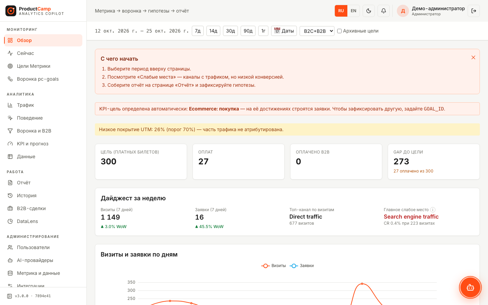

# ProductCamp Conversion Analytics

> 🇷🇺 Русский · [🇬🇧 English](README.en.md)

[](https://github.com/Fighter90/ai-product-copilot/actions/workflows/ci.yml)
[](https://github.com/Fighter90/ai-product-copilot/actions/workflows/e2e.yml)
[](https://github.com/Fighter90/ai-product-copilot/actions/workflows/security.yml)
[](https://github.com/Fighter90/ai-product-copilot/actions/workflows/docs-links.yml)


**Стенд:** [dashboardcamp.ru](https://dashboardcamp.ru) — лендинг и справка открыты всем, кабинет —
после входа.

Многопользовательский аналитический кабинет трека **«Конверсии и лидген» ProductCamp**:
Яндекс.Метрика → SQLite (история по дням) → личный кабинет с ролями и аудитом, мониторинг
реального времени, отчёты DOCX/PDF с AI-анализом, экспорт в Яндекс DataLens, RAG-ассистент
по справке. Методология гипотез (Double Diamond + ICE = I × C × E) встроена в отчёт.

> **KPI кампании:** 300+ **платных** билетов. Везде в инструменте: **заявка ≠ оплата**.

> ✅ **Статус: рабочий продукт v3.4.55.** Личный кабинет: аутентификация по сессиям, роли
> **Администратор / Аналитик**, журнал действий (аудит). Мониторинг реального времени: Live,
> Цели (+деталь цели), Воронка live. Аналитика: Трафик, Поведение, Воронка, KPI, Исследуй
> (пресеты), Отчёт, История, B2B, DataLens. Админка: Пользователи, AI-провайдеры
> (OpenRouter/Anthropic/YandexGPT/GigaChat — ключи шифруются AES-256-GCM), Яндекс.Метрика,
> Интеграции, Аудит. Справка + RAG-ассистент. Интерфейс ru/en, тёмная/светлая тема, версия
> в футере. Деплой на Ubuntu: nginx + systemd + certbot ([docs/deploy.md](docs/deploy.md)).

## Стенд и демо-доступ

- **Прод:** <https://dashboardcamp.ru> — публичны лендинг (`/`), справка (`/help`) и
  RAG-ассистент; всё под `/app` открывается только после входа (`/login`).
- **Демо-доступ** к стенду выдаёт администратор проекта: он создаёт учётную запись с ролью
  «Аналитик» (или «Администратор») и передаёт одноразовый пароль защищённым каналом. Логины и
  пароли в репозитории **не публикуются** — ни здесь, ни в `docs/`.
- **Локально** демо-аккаунты включаются флагом `DEMO_USERS=1` — пароли задаются в вашем `.env`
  (`DEMO_ADMIN_PASSWORD`, `DEMO_ANALYST_PASSWORD`). На проде `DEMO_USERS=0`.

## Скриншоты

> Реальные скриншоты прод-версии (1440×900); полный набор из 24 экранов — в
> [code/frontend/public/screenshots](code/frontend/public/screenshots).

| Лендинг                                | Обзор: успеваем к 300?                | Реальное время                   |
| -------------------------------------- | ------------------------------------- | -------------------------------- |
|  |  |  |

| Воронка pc-goals                                    | Отчёт                               | RAG-ассистент                                  |
| --------------------------------------------------- | ----------------------------------- | ---------------------------------------------- |
|  |  |  |

## Возможности

- **Личный кабинет** — вход по сессиям (cookie HttpOnly, хэш токена в БД), роли
  Администратор/Аналитик (RBAC на бэкенде и в UI), журнал действий (аудит).
- **Реальное время** — Live-лента, все цели счётчика со статусами, воронка PC-событий
  (просмотр билетов → CTA → регистрация → корзина → заказ) — напрямую через Reporting API.
- **Аналитика по дням** — каналы, UTM, гео+устройства, страницы входа/выхода, воронка
  «визит → заявка → оплата», KPI 300 с «Что если»-симулятором, пресеты «Исследуй» (11 срезов).
- **Резервный аккаунт Метрики** — независимая суточная квота API: при `429 quota_requests_by_uid`
  клиент автоматически повторяет запрос под резервным токеном (sync, cli-sync и live-страницы);
  настройка — карточка «Резервный аккаунт Метрики» в админке (ClientID/Secret, обмен
  Verification Code на токен).
- **Устойчивость живых экранов** — при любом сбое Метрики (квота, сбой API) live-страницы
  показывают последние доступные данные с баннером, а не ошибку; live-запросы ограничены
  31 днём, полная история — в разделах из БД (SQLite), от квот не зависящих.
- **Отчёты** — неизменяемый снапшот → DOCX/PDF по ГОСТ с графиками; фронт-материя ГОСТ-2
  (поле-оглавление, перечень рисунков, обозначения и термины, введение, резюме), таблицы
  с рамками, подписи «Рисунок N», человекочитаемый период на титуле; AI-анализ, AI-гипотезы
  и AI Decision Log.
- **AI-провайдеры (4)** — OpenRouter, Anthropic, YandexGPT, GigaChat; цепочка по приоритету с
  фоллбэком; ключи шифруются AES-256-GCM; кнопка «Проверить соединение»; статистика вызовов за
  30 дней.
- **Справка и ассистент** — раздел `/help` (статьи из `docs/help/ru|en`) и RAG-ассистент
  (правый нижний угол), отвечающий только по текстам справки.
- **i18n ru/en и темы** — переключатели в шапке; выбор сохраняется в браузере и профиле;
  тёмная/светлая тема; версия продукта в футере.

### Интеграции

| Интеграция         | Что делает                                                                                                                                                                                 | Где настраивается                                  |
| ------------------ | ------------------------------------------------------------------------------------------------------------------------------------------------------------------------------------------ | -------------------------------------------------- |
| Яндекс.Метрика     | Stat API → SQLite (история по дням, cron-синк); Reporting API — live-страницы без записи в БД; Management API — создание/архивация/восстановление целей (`metrika:write`)                  | «Администрирование → Метрика и данные»             |
| Яндекс DataLens    | 5 CSV-датасетов для Files-подключения; проверка подключения к DataLens Public API (Org ID, Workbook ID, IAM-токен); webhook-приёмник с кодом подтверждения; ссылки на дашборды для команды | «Администрирование → Интеграции»                   |
| LLM-провайдеры (4) | OpenRouter · Anthropic · YandexGPT (AI Studio, `folderId`) · GigaChat (`scope`, TLS через Russian Trusted Root CA) — AI-анализ отчёта, AI-гипотезы, AI Decision Log, RAG-ассистент         | «Администрирование → AI-провайдеры»                |
| Отчёты             | DOCX (`docx`) и PDF (headless Chrome) по ГОСТ, графики ECharts рендерятся на сервере                                                                                                       | страница «Отчёт»; `PUPPETEER_EXECUTABLE_PATH`      |
| Уведомления        | колокольчик в кабинете: коды/алерты DataLens, запросы аналитиков                                                                                                                           | автоматически; аудит — «Администрирование → Аудит» |

## Quickstart

### Одной командой

```bash
git clone git@github.com:Fighter90/ai-product-copilot.git
cd ai-product-copilot
./setup.sh          # install → init → start
```

### По шагам (install → init → start)

```bash
pnpm install        # 1. зависимости (pnpm workspace: backend / frontend / shared)
./init.sh           # 2. интерактивный .env: Метрика, AI, первый админ (+ опц. OAuth)
./run.sh            # 3. миграции → sync (или демо-seed без токена) → кабинет
```

Откроется `http://localhost:5173` — лендинг → `/login`. Первый администратор создаётся при старте
из `ADMIN_EMAIL`/`ADMIN_PASSWORD` (`.env`); `DEMO_USERS=1` добавляет демо-админа и демо-аналитика
для локального просмотра (пароли — `DEMO_ADMIN_PASSWORD` / `DEMO_ANALYST_PASSWORD` в вашем `.env`).
API — `http://localhost:4000` (Swagger — `/docs`).

> Без токена и без AI-ключей всё работает в демо-режиме — удобно показать инструмент сразу.

Подробный разбор запуска — в [docs/quickstart.md](docs/quickstart.md) и
[docs/runbook.md](docs/runbook.md); руководство пользователя —
[docs/user-guide.md](docs/user-guide.md); деплой на сервер — [docs/deploy.md](docs/deploy.md).

## Как получить `YANDEX_OAUTH_TOKEN`

Нужен токен со scope `metrika:read`. Документация Яндекс ID: https://yandex.ru/dev/id/doc/ru/.

### Способ 1 (рекомендуется) — встроенный помощник `pnpm auth`

```bash
pnpm auth        # из корня репозитория
```

1. Помощник печатает ссылку авторизации (`response_type=code`). Подтвердите доступ в браузере.
2. Скопируйте **код подтверждения** и вставьте обратно в терминал.
3. Помощник обменяет код на токен и **сам впишет** `YANDEX_OAUTH_TOKEN` в `.env`. Дальше: `pnpm sync`.

### Способ 2 (вручную) — implicit flow

Откройте `https://oauth.yandex.ru/authorize?response_type=token&client_id=<YANDEX_CLIENT_ID>`,
подтвердите доступ и скопируйте токен из адресной строки (`#access_token=...`) в `.env`.

Токен и секреты хранятся **только** в `.env` (в `.gitignore`) либо в зашифрованном виде в БД
(настройки админа). Никогда не коммитьте их.

## Переменные окружения

Источник истины — `code/backend/src/config.ts` (Zod-схема) и `.env.example`; полный разбор
серверного `.env` — в [docs/deploy.md](docs/deploy.md). Значения ниже — **дефолты**, не секреты.

**Кабинет и безопасность**

| Переменная                                      | По умолчанию              | Назначение                                                                                       |
| ----------------------------------------------- | ------------------------- | ------------------------------------------------------------------------------------------------ |
| `APP_SECRET`                                    | —                         | **обязателен на сервере**: мастер-ключ AES-256-GCM для секретов в БД (`openssl rand -base64 32`) |
| `ADMIN_EMAIL` / `ADMIN_PASSWORD` / `ADMIN_NAME` | `admin@productcamp.local` | загрузочный администратор — создаётся при старте, пока таблица `users` пуста                     |
| `DEMO_USERS`                                    | `0`                       | `1` — создать демо-админа и демо-аналитика (только локально)                                     |
| `DEMO_ADMIN_PASSWORD` / `DEMO_ANALYST_PASSWORD` | —                         | пароли демо-аккаунтов при `DEMO_USERS=1`                                                         |
| `PUBLIC_URL`                                    | `http://localhost:5173`   | публичный адрес кабинета (на проде `https://dashboardcamp.ru`)                                   |
| `COOKIE_SECURE`                                 | `1`                       | флаг `Secure` у сессионной cookie; `0` — только для HTTP без TLS вне `localhost`                 |
| `SESSION_DAYS`                                  | `7`                       | срок жизни сессии, дней                                                                          |
| `TRUST_PROXY`                                   | —                         | `1` — доверять `X-Forwarded-For` (backend за nginx)                                              |

**Яндекс.Метрика** (первичные значения; дальше админ правит их в UI — они перекрывают `.env`)

| Переменная                                  | По умолчанию                                | Назначение                                                            |
| ------------------------------------------- | ------------------------------------------- | --------------------------------------------------------------------- |
| `YANDEX_OAUTH_TOKEN`                        | —                                           | OAuth-токен: `metrika:read` (+ `metrika:write` для управления целями) |
| `METRIKA_BACKUP_OAUTH_TOKEN`                | —                                           | токен резервного аккаунта: при 429 per-UID клиент уходит на его квоту |
| `METRIKA_BACKUP_CLIENT_ID` / `_SECRET`      | —                                           | OAuth-приложение резервного аккаунта (обмен кода в админке)           |
| `YANDEX_CLIENT_ID` / `YANDEX_CLIENT_SECRET` | —                                           | OAuth-приложение для `pnpm auth`                                      |
| `OAUTH_REDIRECT_URI`                        | `https://oauth.yandex.ru/verification_code` | redirect URI OAuth-приложения                                         |
| `COUNTER_ID`                                | `0`                                         | номер счётчика; `0` — не задан (работает демо-режим)                  |
| `GOAL_ID`                                   | `0`                                         | KPI-цель; `0` — автоопределение цели-покупки при синке                |
| `TIMEZONE`                                  | `Europe/Moscow`                             | часовой пояс дневных агрегатов                                        |
| `ARCHIVED_GOAL_ID_THRESHOLD`                | `77`                                        | id целей ниже порога считаются архивными                              |
| `LOW_UTM_COVERAGE_RATIO`                    | `0.7`                                       | порог флага `low_utm_coverage`                                        |
| `INCLUDE_TEST_TRAFFIC`                      | —                                           | `1` — не исключать роботов и тестовые сессии (`file:`) при синке      |

**AI-провайдеры** (необязательный seed при пустой таблице `ai_providers`; основной путь — UI)

| Переменная                                                      | По умолчанию                               | Назначение                                                                                                                                             |
| --------------------------------------------------------------- | ------------------------------------------ | ------------------------------------------------------------------------------------------------------------------------------------------------------ |
| `OPENROUTER_API_KEY` / `OPENROUTER_MODEL`                       | — / `anthropic/claude-sonnet-4.5`          | OpenRouter                                                                                                                                             |
| `ANTHROPIC_API_KEY` / `ANTHROPIC_MODEL`                         | — / `claude-sonnet-4-6`                    | Anthropic                                                                                                                                              |
| `YANDEX_AI_API_KEY` / `YANDEX_AI_FOLDER_ID` / `YANDEX_AI_MODEL` | — / — / `yandexgpt/latest`                 | YandexGPT (AI Studio)                                                                                                                                  |
| `GIGACHAT_AUTH_KEY` / `GIGACHAT_SCOPE` / `GIGACHAT_MODEL`       | — / `GIGACHAT_API_PERS` / `GigaChat-2-Pro` | GigaChat                                                                                                                                               |
| `NODE_EXTRA_CA_CERTS`                                           | —                                          | PEM с Russian Trusted Root/Sub CA (Минцифры) — без него GigaChat падает с `SELF_SIGNED_CERT_IN_CHAIN`; на проде `deploy/deploy.sh` прописывает его сам |

**Сервер и рендер**

| Переменная                  | По умолчанию                 | Назначение                                                |
| --------------------------- | ---------------------------- | --------------------------------------------------------- |
| `API_PORT` / `PORT`         | `4000` / `5173`              | порт API / порт dev-сервера фронтенда                     |
| `HOST`                      | `0.0.0.0`                    | адрес прослушивания API (на проде `127.0.0.1` за nginx)   |
| `DB_PATH`                   | `data/productcamp.sqlite`    | файл SQLite                                               |
| `HELP_DIR`                  | `docs/help`                  | каталог статей справки и RAG-ассистента                   |
| `PUPPETEER_EXECUTABLE_PATH` | авто-поиск Chrome            | путь к Chrome/Chromium для PDF                            |
| `ECHARTS_PATH`              | `echarts.min.js` из frontend | UMD-сборка ECharts для серверного рендера графиков отчёта |
| `LOG_LEVEL` / `NODE_ENV`    | `info` / —                   | уровень логов pino / режим                                |
| `BUILD_SHA`                 | —                            | git-sha сборки в `/api/health`                            |

**Runtime-настройки в БД (без `.env`).** Часть параметров задаётся только в админке и хранится в
`app_settings` (секреты — шифротекстом): `ORDER_GOAL_ID`, `KPI_TARGET`, `TEST_TRAFFIC_PATTERNS`,
`DATALENS_WEBHOOK_TOKEN`, `DATALENS_LINKS`, а также подключение к DataLens Public API —
`DATALENS_ORG_ID`, `DATALENS_WORKBOOK_ID`, `DATALENS_IAM_TOKEN` («Администрирование →
Интеграции → Подключение DataLens», кнопка «Проверить подключение»). Скрипт
`scripts/push-datalens.mjs` читает `DATALENS_IAM_TOKEN`/`DATALENS_ORG_ID` из окружения процесса.

## Архитектура

```
Яндекс.Метрика ──sync (дневные чанки)──▶ SQLite ──API (Fastify, сессии/RBAC)──▶ Кабинет (React)
        │                                  │                                        │
        └── live: Reporting API напрямую ──┘── DataLens (CSV) · DOCX/PDF + AI · RAG-ассистент ──┘
```

Схемы компонентов, потоков данных и аутентификации (Mermaid) —
[docs/architecture.md](docs/architecture.md); модель БД (миграции 001..011) —
[docs/data-model.md](docs/data-model.md).

## Документация

> 📖 **GitHub Wiki** ([ai-product-copilot/wiki](https://github.com/Fighter90/ai-product-copilot/wiki)):
> Быстрый старт · Роли и права · AI-провайдеры · Метрика и цели · DataLens · Деплой · FAQ —
> RU + EN. Исходники — [docs/wiki/](docs/wiki), публикация — `scripts/publish-wiki.sh`.

| Документ                                     | Для кого                  | Что внутри                                                            |
| -------------------------------------------- | ------------------------- | --------------------------------------------------------------------- |
| [docs/user-guide.md](docs/user-guide.md)     | аналитик, администратор   | руководство пользователя v3 по ролям и страницам                      |
| [docs/admin-guide.md](docs/admin-guide.md)   | администратор             | пользователи, AI-провайдеры и ключи, Метрика, DataLens, аудит, бэкапы |
| [docs/guides/](docs/guides/README.md)        | все                       | то же руководство одним файлом: DOCX и PDF (`pnpm guides`)            |
| [docs/quickstart.md](docs/quickstart.md)     | разработчик               | локальный запуск по шагам                                             |
| [docs/runbook.md](docs/runbook.md)           | разработчик, эксплуатация | запуск, экспорт отчётов, траблшутинг                                  |
| [docs/deploy.md](docs/deploy.md)             | эксплуатация              | Ubuntu + nginx + systemd + certbot, серверный `.env`                  |
| [deploy/DEPLOY.md](deploy/DEPLOY.md)         | эксплуатация              | деплой на dashboardcamp.ru, бэкапы, мониторинг, восстановление        |
| [docs/architecture.md](docs/architecture.md) | разработчик               | компоненты, потоки данных, аутентификация/RBAC, AI-слой               |
| [docs/data-model.md](docs/data-model.md)     | разработчик               | таблицы SQLite и инварианты                                           |
| [docs/help/ru](docs/help/ru)                 | все                       | статьи встроенной справки (`/help`) — источник RAG-ассистента         |
| [CHANGELOG.md](CHANGELOG.md)                 | все                       | история релизов (Keep a Changelog)                                    |

English versions: [README.en.md](README.en.md), [docs/en/](docs/en/user-guide.md).

## Технологический стек

Backend: Node 22 · TypeScript 5 strict · Fastify 5 (tsx) · Zod · better-sqlite3 · undici ·
`docx` · puppeteer-core · pino.
Frontend: React 18 · Vite · TailwindCSS · Apache ECharts · TanStack Table/Query · Zustand ·
react-router · i18n ru/en.
Инфраструктура: pnpm 9 · Vitest · Playwright · ESLint + Prettier · GitHub Actions · nginx/systemd
на деплое.

Добавление зависимостей вне списка требует ADR в `docs/decisions/`.

## Роли

|                                             | Аналитик | Администратор |
| ------------------------------------------- | :------: | :-----------: |
| Обзор, Live, Цели, Воронка live             |    ✅    |      ✅       |
| Трафик, Поведение, Воронка, KPI, Исследуй   |    ✅    |      ✅       |
| Отчёт, История, B2B, DataLens               |    ✅    |      ✅       |
| Справка, RAG-ассистент, ru/en, темы         |    ✅    |      ✅       |
| Пользователи (создание, роли, сброс пароля) |    —     |      ✅       |
| AI-провайдеры (ключи, модели, приоритеты)   |    —     |      ✅       |
| Настройки Яндекс.Метрики, синхронизация     |    —     |      ✅       |
| Интеграции (DataLens API, webhook) и аудит  |    —     |      ✅       |
| Управление целями Метрики (API)             |    —     |      ✅       |

Права проверяются на бэкенде (`/api/admin/**`, мутации настроек — только admin); все значимые
действия пишутся в `audit_log`.

## AI-провайдеры

Администратор настраивает провайдеров в «Администрирование → AI-провайдеры»:

| Провайдер  | Ключ                 | Доп. поля  | Пример модели                 |
| ---------- | -------------------- | ---------- | ----------------------------- |
| OpenRouter | API key              | —          | `anthropic/claude-sonnet-4.5` |
| Anthropic  | API key              | —          | `claude-sonnet-4-6`           |
| YandexGPT  | API-ключ (AI Studio) | `folderId` | `yandexgpt/latest`            |
| GigaChat   | Authorization Key    | `scope`    | `GigaChat-2-Pro`              |

Включённые провайдеры образуют **цепочку по приоритету**: сбой или таймаут одного автоматически
переключает на следующий. Ключи шифруются AES-256-GCM мастер-ключом `APP_SECRET` и хранятся только
шифротекстом в БД. AI потребляют: отчёт (анализ/гипотезы/Decision Log) и RAG-ассистент по справке.
Ключи в `.env` — только первичный seed, необязательны.

## Язык и темы

- **RU/EN** — переключатель в шапке кабинета; язык сохраняется в браузере и в профиле
  (`PATCH /api/auth/me`); справка и ассистент отвечают на языке интерфейса.
- **Тёмная/светлая тема** — переключатель в шапке; применяется до первой отрисовки.
- **Версия в футере** — берётся из корневого `package.json` + git-sha сборки.

## Структура проекта

```
.
├── code/
│   ├── backend/    # Fastify API: auth/RBAC, настройки, AI-провайдеры, live, help, DataLens,
│   │               #   Metrika-клиент, SQLite (миграции 001..011), отчёты DOCX/PDF
│   ├── frontend/   # React+Vite кабинет: public/app/admin страницы, i18n, темы, ассистент
│   └── shared/     # общие типы и константы (@pca/shared)
├── deploy/         # конфигурации сервера (nginx, systemd) — docs/deploy.md
├── docs/           # architecture, data-model, deploy, user-guide (ru/en), runbook, help/ru|en,
│                   #   decisions/ (ADR), specs/
├── e2e/            # Playwright
├── QA/             # промпты тестирования
├── data/           # SQLite + отчёты (gitignored)
└── setup.sh / init.sh / run.sh   # локальный запуск одной командой
```

Полный гид — [docs/project-structure.md](docs/project-structure.md).

## CLI-команды

| Команда                                            | Описание                                                   |
| -------------------------------------------------- | ---------------------------------------------------------- |
| `./setup.sh`                                       | всё одной командой: install → init → start                 |
| `./init.sh`                                        | инициализация .env (Метрика, AI, первый админ, опц. OAuth) |
| `./run.sh`                                         | запуск: миграции → sync/seed → кабинет                     |
| `pnpm auth`                                        | OAuth Яндекс.Метрики → `YANDEX_OAUTH_TOKEN` в .env         |
| `pnpm seed`                                        | наполнить БД демо-данными (без токена)                     |
| `npm run sync` (`pnpm --filter @pca/backend sync`) | живая выгрузка из Метрики за период                        |
| `pnpm dev`                                         | backend (tsx watch) + frontend (vite)                      |
| `pnpm build` / `pnpm typecheck`                    | сборка / проверка типов                                    |
| `pnpm lint` / `pnpm format:check`                  | линт / проверка форматирования                             |
| `pnpm test` / `pnpm coverage`                      | vitest / покрытие                                          |
| `pnpm e2e`                                         | Playwright                                                 |

## Методология (Double Diamond + структурированный формат гипотезы)

- **Формат гипотезы:** «{subject} {action} {solution}, если {condition}».
- **≥3 скрытых допущения** в категориях behavior / market / tech; **≥2 способа проверки**.
- **ICE = I × C × E (произведение, 1–1000)** — `docs/decisions/005-ice-product-vs-mean.md`.
- **Светофор** (🟢/🟡/🔴) + дедлайн проверки; **Decision Log** замыкает цикл.

Методология — `docs/methodology-hypotheses.md`; AI-гипотезы и AI Decision Log генерируются внутри
отчёта.

## Деплой на сервер

Ubuntu + nginx + systemd + certbot: пошаговая инструкция, юнит systemd и конфиг nginx — в
[docs/deploy.md](docs/deploy.md); конфиги складываются в `deploy/`. Ключевое требование продакшена:
`APP_SECRET` (мастер-ключ шифрования секретов в БД) и `COOKIE_SECURE=1` за HTTPS.

## CI/CD

- **ci.yml** — `lint → format:check → typecheck → coverage → build` + actionlint + gate;
- **e2e.yml** — Playwright (smoke кабинета);
- **security.yml** — gitleaks + `pnpm audit` (high+);
- **review.yml** — AI code-review (при `ANTHROPIC_API_KEY` в секретах репо);
- **pr-lint.yml** — Conventional PR title;
- **release.yml** — по тегу `v*.*.*`: verify → упаковка → GitHub Release.

## Разработка по спецификациям

Нетривиальные фичи проходят спеку до кода: `docs/specs/NNN-*.md` (цикл spec → review → plan →
tests → impl). Реестр — `docs/specs/README.md`.

## Known limitations

- B2B — ручной ввод (`b2b_manual`), Метрика B2B-пайплайн не покрывает.
- UTM-разметка неравномерная: сегменты с покрытием < 70% помечаются `low_utm_coverage`.
- `ym:s:exitURL` не поддерживается Stat API → «Страницы выхода» на живых данных пустые.
- PDF требует Chrome (`PUPPETEER_EXECUTABLE_PATH`); DOCX — без зависимостей.
- Live-страницы зависят от доступности Reporting API и не кэшируются.

## Релизы

Полная история — [CHANGELOG.md](CHANGELOG.md). Последние:

| Версия              | Дата       | Описание                                                                                                                                                                                                                                               |
| ------------------- | ---------- | ------------------------------------------------------------------------------------------------------------------------------------------------------------------------------------------------------------------------------------------------------ |
| **v3.4.1** (Latest) | 2026-11-05 | Live-страницы переживают любой сбой Метрики (stale-кэш + человекочитаемые 503), корень «Bad Request» устранён (clamp live-окон 31 день); финальная по-ключевая сверка — OVERALL PASS на 556 днях × 4 таблицы                                           |
| v3.4.0              | 2026-11-05 | Резервный аккаунт Метрики (ANA-107), фолбэк квоты во всех путях, верификация 22/22 багов, CSP-шрифты, perf, range-запросы ≤31 дня                                                                                                                      |
| v3.3.1              | 2026-10-29 | REG-01..12: демо-доступы, 400 вместо 500, «оплачено»-границы, покрытие периода, статусы синка, снапшоты, security                                                                                                                                      |
| v3.3.0              | 2026-10-28 | 30-минутный синк, импорт «статы» (маркетинг), справка, дубли целей                                                                                                                                                                                     |
| v3.2.0              | 2026-10-27 | См. [CHANGELOG.md](CHANGELOG.md)                                                                                                                                                                                                                       |
| v3.1.0              | 2026-10-26 | Справка ×2.5 RU/EN со скриншотами прода; отчёты по ГОСТ-2 (TOC, перечень рисунков, таблицы с рамками); см. [CHANGELOG.md](CHANGELOG.md)                                                                                                                |
| v3.0.0              | 2026-10-25 | Личный кабинет: сессии, роли (админ/аналитик), аудит; Live/Цели/Воронка live; админка (Пользователи, AI-провайдеры ×4, Метрика, Интеграции, Аудит); DataLens (CSV + webhook); RAG-ассистент и Справка; i18n ru/en и темы; деплой nginx/systemd/certbot |
| v2.10.0             | 2026-05-29 | `./init.sh` собирает OAuth-доступы Яндекс.Метрики (ClientID/secret)                                                                                                                                                                                    |
| v2.9.5              | 2026-05-29 | ICE в AI-анализе — произведение (I×C×E), не среднее                                                                                                                                                                                                    |

## License · Authors · Credits

- Авторы: команда трека «Конверсии и лидген» ProductCamp.
