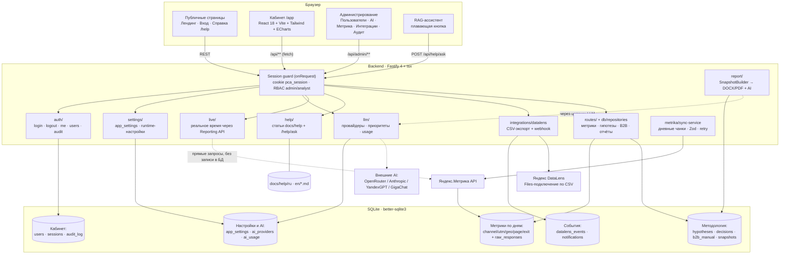
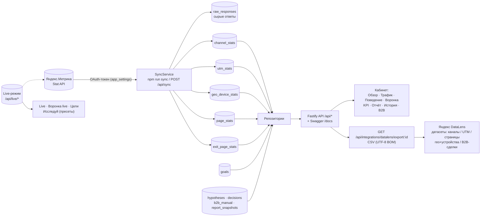
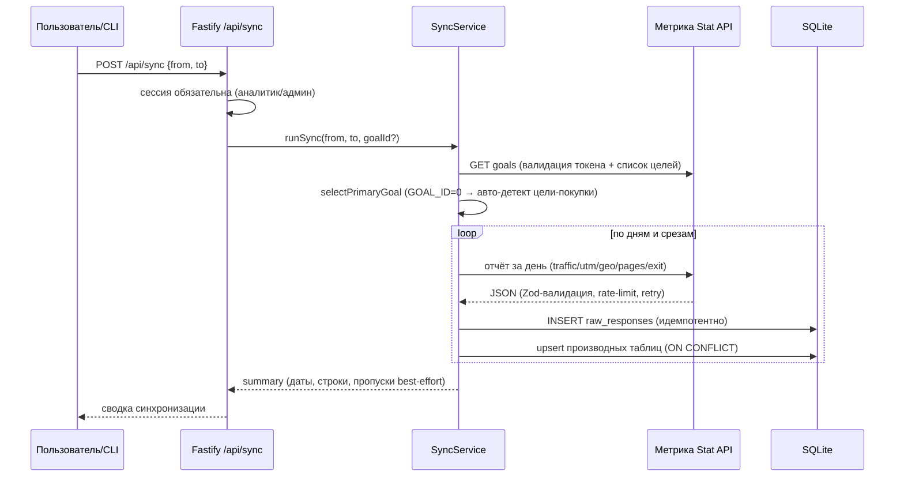
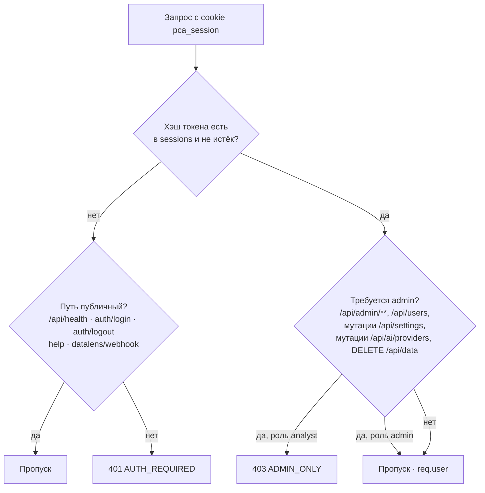
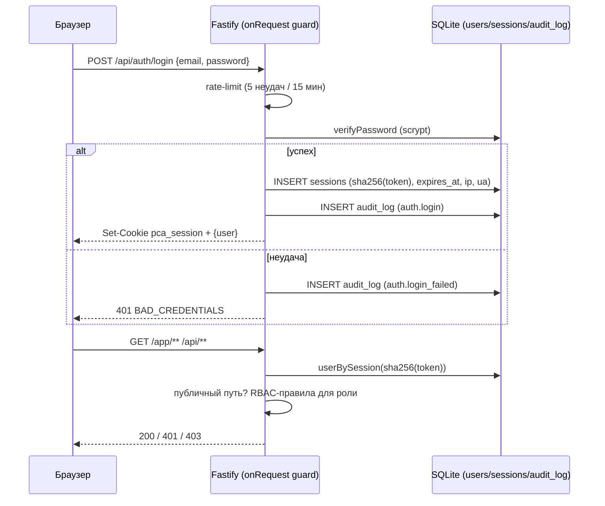

# Архитектура

> 🇷🇺 Русский. Обзорный документ; детали — в ADR (`docs/decisions/`) и коде.

v3 — многопользовательский **личный кабинет** поверх аналитического инструмента: парсит
Яндекс.Метрику → SQLite → API → кабинет (роли, аудит) + DataLens + AI-провайдеры.
Публичная часть (лендинг, вход, справка) — без сессии; всё под `/app` — только после логина.

**Текущая версия:** v3.0.0 (2026-10-25)

## Компоненты

## Поток данных: Метрика → SQLite → API → кабинет / DataLens

Ключевое:

- **История — по дням.** Повторный sync добавляет даты (`INSERT … ON CONFLICT`), не затирая прошлое;
  отсюда WoW-сравнения и воспроизводимость. Каждое число прослеживается до `raw_responses`.
- **Live-страницы не пишут в БД** — `/api/live/*` ходит в Reporting API напрямую с токеном из
  `app_settings` (реальное время за выбранный период).
- **DataLens** получает плоские CSV-датасеты (`integrations/datalens.ts`, 5 датасетов) по
  авторизованному экспорту; обратный канал — webhook-приёмник с токеном (`datalens_events`,
  уведомления админам).

### Синхронизация (sequence)

## Аутентификация и RBAC

- Пароли — **scrypt** (per-user salt, `security/crypto.ts`); в БД только `password_hash`.
- Сессии — cookie `pca_session` (HttpOnly, SameSite=Lax, `Secure` при `COOKIE_SECURE=1`);
  в БД хранится только **sha256-хэш** токена + срок, ip, user-agent (`sessions`).
- Загрузочный администратор создаётся при старте из `ADMIN_EMAIL`/`ADMIN_PASSWORD`, когда таблица
  `users` пуста; `DEMO_USERS=1` добавляет демо-аккаунты (админ + аналитик).
- Ограничение входа: 5 неудач за 15 минут на пару ip+email → 429.
- Роли: **Администратор** (всё) и **Аналитик** (аналитика, отчёты, B2B, DataLens-экспорт — без
  администрирования). Права проверяются на бэкенде (правила ниже) и в UI (`RequireAdmin`).

## Кабинет: страницы и права

| Раздел    | Страница      | URL                            | Доступ          |
| --------- | ------------- | ------------------------------ | --------------- |
| Монитор   | Обзор         | `/app`                         | аналитик, админ |
|           | Live          | `/app/live`                    | аналитик, админ |
|           | Цели + деталь | `/app/goals`, `/app/goals/:id` | аналитик, админ |
|           | Воронка live  | `/app/funnel-live`             | аналитик, админ |
| Аналитика | Трафик        | `/app/traffic`                 | аналитик, админ |
|           | Поведение     | `/app/behavior`                | аналитик, админ |
|           | Воронка       | `/app/funnel`                  | аналитик, админ |
|           | KPI           | `/app/kpi`                     | аналитик, админ |
|           | Исследуй      | `/app/explore/:preset`         | аналитик, админ |
| Работа    | Отчёт         | `/app/report`                  | аналитик, админ |
|           | История       | `/app/history`                 | аналитик, админ |
|           | B2B           | `/app/b2b`                     | аналитик, админ |
|           | DataLens      | `/app/datalens`                | аналитик, админ |
| Админ     | Пользователи  | `/app/admin/users`             | **админ**       |
|           | AI-провайдеры | `/app/admin/ai`                | **админ**       |
|           | Метрика       | `/app/admin/metrika`           | **админ**       |
|           | Интеграции    | `/app/admin/integrations`      | **админ**       |
|           | Аудит         | `/app/admin/audit`             | **админ**       |

Публичные: `/` (лендинг), `/login`, `/help` + `/help/:slug` (справка из `docs/help`).
До-v3 URL (`/traffic`, `/report`, `/settings`, …) редиректят в `/app/…` с сохранением query.

## AI-слой

- Провайдеры: **OpenRouter · Anthropic · YandexGPT · GigaChat** (`llm/providers.ts`,
  `PROVIDER_META` с моделями и доп. полями: `folderId` у YandexGPT, `scope` у GigaChat).
- Ключи вводятся в «Администрирование → AI-провайдеры», шифруются **AES-256-GCM** мастер-ключом
  `APP_SECRET` и хранятся в `ai_providers.secret_enc` (`iv:tag:ciphertext`, base64). В `.env` ключи
  — только первичные значения (seed) и не обязательны.
- **Цепочка по приоритету:** `LlmService.complete` идёт по включённым провайдерам в порядке
  `priority`; ошибка/таймаут → следующий провайдер. Для совместимости старый Anthropic-интерфейс
  отчётов оборачивается в `chainAsAnthropicFetch`.
- Каждый вызов пишется в `ai_usage` (провайдер, модель, назначение, объём, мс, ошибка) —
  админ видит статистику за 30 дней.
- Потребители AI: отчёт (AI-анализ, AI-гипотезы, AI Decision Log) и RAG-ассистент по справке
  (`POST /api/help/ask` — ответ только из чанков статей `docs/help/<lang>`).

## Слои

| Слой           | Где                                     | Технологии                                                                       |
| -------------- | --------------------------------------- | -------------------------------------------------------------------------------- |
| Клиент         | `code/frontend/src/`                    | React 18, Vite, Tailwind, ECharts, TanStack, Zustand, i18n ru/en                 |
| Аутентификация | `code/backend/src/auth/` + `security/`  | cookie-сессии, scrypt, sha256, rate limiter, audit                               |
| Настройки      | `code/backend/src/settings/`            | `app_settings`, AES-256-GCM (`APP_SECRET`), runtime-override `.env` без рестарта |
| Извлечение     | `code/backend/src/metrika/`             | undici fetch, Zod, token-bucket, retry, дневные чанки                            |
| Live           | `code/backend/src/live/`                | прямые запросы Reporting API (без записи в БД)                                   |
| Хранение       | `code/backend/src/db/`                  | better-sqlite3, WAL + FK, миграции 001..010, репозитории                         |
| AI             | `code/backend/src/llm/`                 | 4 провайдера, цепочка по приоритету, `ai_usage`                                  |
| Справка        | `code/backend/src/help/` + `docs/help/` | markdown + front matter, RAG-поиск чанков, `/help/ask`                           |
| Интеграции     | `code/backend/src/integrations/`        | DataLens CSV-экспорт + webhook-приёмник                                          |
| Отчёты         | `code/backend/src/report/`              | SnapshotBuilder → DOCX (`docx`) / PDF (Puppeteer) + AI                           |
| API            | `code/backend/src/app.ts`, `routes/`    | Fastify 4, Zod, Swagger `/docs`                                                  |

## Ключевые решения

- SQLite без Docker; история по дням (`decisions/002`, `007`).
- ICE = произведение (`decisions/005`); PDF через Puppeteer (`decisions/003`); B2B — ручной ввод
  (`decisions/004`).
- Сессии — server-side таблица `sessions` с хранением только хэша токена; cookie HttpOnly.
- Секреты (токены Метрики, ключи AI) — только в зашифрованном виде в БД; `.env` — seed при первом
  старте. На сервере `APP_SECRET` обязателен (см. `docs/deploy.md`).
- Live-страницы не кэшируются в SQLite — реальное время ценой прямого запроса к Метрике.
- Версия в футере кабинета — `__APP_VERSION__` из корневого `package.json` + короткий git-sha
  (`vite.config.ts`), дублируется в `/api/health`.
