# Модель данных (SQLite)

> Источник истины — миграции `code/backend/src/db/migrations/001..017`. Доступ только через
> репозитории (`code/backend/src/db/repositories/`). История копится **по дням** (см. ADR-007).
> БД: `data/productcamp.sqlite` (gitignored), `better-sqlite3`, WAL + `PRAGMA foreign_keys=ON`.
> Миграция `010_auth_settings_ai.sql` (v3.0.0) добавляет кабинет: пользователи, сессии, аудит,
> runtime-настройки, AI-провайдеры, события DataLens и уведомления; `013` — доступ аналитика к
> счётчикам (`user_counters`), `016` — журнал синков (`sync_runs`), `017` — B2C-оплаты
> (`b2c_payments`, «заявка ≠ оплата»).

## Обзор таблиц

| Таблица            | Назначение                                         | Ключ / история                                             |
| ------------------ | -------------------------------------------------- | ---------------------------------------------------------- |
| `goals`            | цели Метрики (seed при sync)                       | PK `id`                                                    |
| `raw_responses`    | сырые ответы Stat API (прослеживаемость / кэш)     | UNIQUE `(query_hash, date_from, date_to)` — идемпотентно   |
| `channel_stats`    | нормализованные метрики по каналам                 | PK `(date, channel, utm_source, utm_medium, utm_campaign)` |
| `utm_stats`        | разбивка по UTM source/medium/campaign             | PK `(date, utm_source, utm_medium, utm_campaign)`          |
| `geo_device_stats` | разбивка по стране + типу устройства               | PK `(date, country, device)`                               |
| `page_stats`       | поведение страниц входа (`ym:s:startURL`)          | PK `(date, page)`                                          |
| `exit_page_stats`  | поведение страниц выхода (`ym:s:exitURL`)          | PK `(date, page)`                                          |
| `hypotheses`       | гипотезы методологии (ручные)                      | PK `id`; `ice_score` GENERATED                             |
| `b2b_manual`       | ручной B2B-пайплайн                                | PK `id`; этапы lead/negotiation/invoiced/paid              |
| `report_snapshots` | immutable срезы данных для отчётов                 | PK `id` (ulid)                                             |
| `decisions`        | Decision Log                                       | PK `id`; FK → `hypotheses`; `number` UNIQUE                |
| `users`            | пользователи кабинета (v3)                         | PK `id`; `email` UNIQUE (NO CASE); роли admin/analyst      |
| `sessions`         | серверные сессии (v3)                              | PK `token_hash` (sha256); FK → `users` ON DELETE CASCADE   |
| `audit_log`        | журнал действий (v3)                               | PK `id`; индекс `at`                                       |
| `app_settings`     | runtime-настройки админа, переопределяют .env (v3) | PK `key`; секреты — AES-256-GCM                            |
| `ai_providers`     | AI-провайдеры и их ключи (v3)                      | PK `id` ∈ openrouter/anthropic/yandexgpt/gigachat          |
| `ai_usage`         | журнал вызовов AI (v3)                             | PK `id`                                                    |
| `datalens_events`  | события webhook DataLens (v3)                      | PK `id`; хвост 500 записей                                 |
| `notifications`    | уведомления (колокольчик в кабинете, v3)           | PK `id`; `audience` ∈ admin/all; `read_by` JSON            |
| `user_counters`    | доступ аналитика к счётчикам Метрики (013, ANA-29) | PK `(user_id, counter_id)`; FK → `users` CASCADE           |
| `sync_runs`        | журнал запусков синка (016, ANA-15)                | PK `id`; `status` ∈ running/ok/partial/failed              |
| `b2c_payments`     | оплаченные B2C-билеты по дням (017, ANA-19)        | PK `date`; `source` ∈ manual/csv; «заявка ≠ оплата»        |
| `_migrations`      | трекинг применённых миграций                       | PK `name`                                                  |

> **Где живут AI-гипотезы и AI Decision Log (с v2.7.0).** AI-сгенерированные гипотезы и решения
> хранятся НЕ в таблицах `hypotheses`/`decisions`, а внутри JSON-payload снапшота
> (`report_snapshots.payload.generatedHypotheses` / `.generatedDecisions`). Таблицы `hypotheses` и
> `decisions` остаются для ручной методологии и обратной совместимости API.

## ER-диаграмма

Схема по миграциям 001–017 (показаны ключевые поля; «метрические» таблицы связаны не
внешними ключами, а датой и идемпотентностью `raw_responses`):

```mermaid
erDiagram
    users ||--o{ sessions : "user_id (CASCADE)"
    users ||--o{ audit_log : "user_id"
    users ||--o{ user_counters : "user_id (CASCADE)"
    hypotheses ||--o{ decisions : "hypothesis_id"
    hypotheses ||--o{ hypotheses : "parent_id"
    decisions ||--o{ decisions : "previous_decision_id"

    goals {
        INTEGER id PK
        TEXT name
        TEXT type "purchase|application|…"
        BOOLEAN is_archived
    }
    raw_responses {
        INTEGER id PK
        TEXT endpoint
        TEXT query_hash UK "UNIQUE(query_hash, date_from, date_to)"
        TEXT date_from
        TEXT date_to
        TEXT payload_json
        TEXT fetched_at
    }
    channel_stats {
        TEXT date PK "часть составного PK"
        TEXT channel PK
        INTEGER visits
        REAL conversion_rate
        INTEGER goal_reaches
    }
    utm_stats {
        TEXT date PK
        TEXT utm_source PK
        TEXT utm_medium PK
        TEXT utm_campaign PK
        INTEGER visits
    }
    geo_device_stats {
        TEXT date PK
        TEXT country PK
        TEXT device PK
        INTEGER visits
    }
    page_stats {
        TEXT date PK
        TEXT page PK
        INTEGER visits
    }
    exit_page_stats {
        TEXT date PK
        TEXT page PK
        INTEGER visits
    }
    hypotheses {
        INTEGER id PK
        TEXT title
        TEXT status "draft|in_progress|green|yellow|red|expired"
        INTEGER impact
        INTEGER confidence
        INTEGER ease
        INTEGER ice_score "GENERATED: impact*confidence*ease"
        INTEGER parent_id FK
        TEXT source "manual|ai (014)"
    }
    decisions {
        INTEGER id PK
        TEXT number UK "DL-NNN"
        INTEGER hypothesis_id FK
        TEXT outcome "green|yellow|red"
        INTEGER previous_decision_id FK
    }
    b2b_manual {
        INTEGER id PK
        TEXT company
        INTEGER tickets
        TEXT stage "lead|negotiation|invoiced|paid"
        TEXT date_added
    }
    b2c_payments {
        TEXT date PK
        INTEGER payments
        TEXT source "manual|csv (017)"
    }
    report_snapshots {
        TEXT id PK "ulid"
        TEXT generated_at
        TEXT date_from
        TEXT date_to
        TEXT payload_json "включая AI-гипотезы"
    }
    sync_runs {
        INTEGER id PK
        TEXT status "running|ok|partial|failed"
        TEXT date_from
        TEXT date_to
        TEXT started_at
        TEXT finished_at
    }
    users {
        INTEGER id PK
        TEXT email UK "COLLATE NOCASE"
        TEXT password_hash
        TEXT role "admin|analyst"
        TEXT locale "ru|en"
        BOOLEAN is_active
    }
    sessions {
        TEXT token_hash PK "sha256 токена"
        INTEGER user_id FK
        TEXT expires_at
    }
    audit_log {
        INTEGER id PK
        INTEGER user_id FK
        TEXT action
        TEXT target
        TEXT at "индекс"
    }
    user_counters {
        INTEGER user_id PK "часть PK, FK CASCADE"
        INTEGER counter_id PK "часть PK"
    }
    app_settings {
        TEXT key PK
        TEXT value "секреты AES-256-GCM"
        TEXT updated_at
        TEXT updated_by
    }
    ai_providers {
        TEXT id PK "openrouter|anthropic|yandexgpt|gigachat"
        BOOLEAN enabled
        INTEGER priority
        TEXT model
        TEXT secret_enc
    }
    ai_usage {
        INTEGER id PK
        TEXT provider
        TEXT feature "report|assistant|test"
        INTEGER input_tokens "012"
        INTEGER output_tokens "012"
        TEXT created_at
    }
    datalens_events {
        INTEGER id PK
        TEXT kind "confirmation|alert"
        TEXT payload_json
        TEXT at
    }
    notifications {
        INTEGER id PK
        TEXT audience "admin|all"
        TEXT title
        TEXT body
        TEXT read_by "JSON"
        TEXT at
    }
```



---

## Метрики из Метрики (по дням)

Все таблицы метрик аккумулируют историю **по дням** через колонку `date`: повторный `pnpm sync`
добавляет новые даты (`INSERT … ON CONFLICT`), не затирая прошлые. Это даёт WoW-сравнения и
воспроизводимость. Проценты Метрики (`bounce_rate`, `conversion_rate`) хранятся как **доля 0–1**.

### `goals`

| Колонка       | Тип     | Описание                      |
| ------------- | ------- | ----------------------------- |
| `id`          | INTEGER | id цели Метрики (PK)          |
| `name`        | TEXT    | название цели                 |
| `type`        | TEXT    | тип цели (напр. `e_purchase`) |
| `is_b2b`      | BOOLEAN | признак B2B-цели              |
| `is_archived` | BOOLEAN | архивная/удалённая цель       |
| `synced_at`   | TEXT    | время последней синхронизации |

Основная KPI-цель определяется классификатором `classifyGoal`/`selectPrimaryGoal` (`@pca/shared`):
цель типа «покупка» → её reaches считаются **оплатами**.

### `raw_responses`

| Колонка      | Тип     | Описание                                                         |
| ------------ | ------- | ---------------------------------------------------------------- |
| `id`         | INTEGER | PK (AUTOINCREMENT)                                               |
| `endpoint`   | TEXT    | эндпоинт Stat API                                                |
| `query_hash` | TEXT    | хэш параметров запроса                                           |
| `date_from`  | TEXT    | начало периода                                                   |
| `date_to`    | TEXT    | конец периода                                                    |
| `payload`    | JSON    | **сырой** ответ Метрики — источник правды для anti-hallucination |
| `fetched_at` | TEXT    | время получения                                                  |

UNIQUE `(query_hash, date_from, date_to)` → повторный запрос идемпотентен (кэш). Каждое число
дашборда/отчёта восстановимо отсюда.

### `channel_stats`

| Колонка                                      | Тип          | Описание                            |
| -------------------------------------------- | ------------ | ----------------------------------- |
| `date`                                       | TEXT         | дата (история по дням)              |
| `channel`                                    | TEXT         | канал трафика                       |
| `utm_source` / `utm_medium` / `utm_campaign` | TEXT         | UTM (часть PK; могут быть NULL)     |
| `visits` / `users`                           | INTEGER      | визиты / пользователи               |
| `bounce_rate` / `avg_duration`               | REAL         | отказы (0–1) / средняя длительность |
| `goal_reaches` / `conversion_rate`           | INTEGER/REAL | достижения цели / CR (0–1)          |

> **Агрегация по каналу (v2.6.0).** Запрос трафика идёт по одному измерению `ym:s:lastTrafficSource`
> (без дробления на поисковую систему), `attribution=lastsign`. При записи визиты/пользователи/заявки
> суммируются по каналу — одна строка на `(date, channel, utm…)`, поэтому итоги дашборда совпадают с
> Яндекс.Метрикой после re-sync.

### `utm_stats`, `geo_device_stats`, `page_stats`, `exit_page_stats`

Отдельные таблицы для разных разбивок — **намеренно не объединены** с `channel_stats`: суммирование
разных агрегаций задвоило бы визиты. Пропуски измерений нормализуются в `(none)`.

| Таблица            | Уникальные колонки                         | Метрики                                                   |
| ------------------ | ------------------------------------------ | --------------------------------------------------------- |
| `utm_stats`        | `utm_source`, `utm_medium`, `utm_campaign` | visits, users, goal_reaches, conversion_rate              |
| `geo_device_stats` | `country`, `device`                        | visits, users, goal_reaches, conversion_rate              |
| `page_stats`       | `page` (startURL)                          | visits, users, bounce_rate, goal_reaches, conversion_rate |
| `exit_page_stats`  | `page` (exitURL)                           | visits, users, bounce_rate, goal_reaches, conversion_rate |

> ⚠️ `exit_page_stats` на живых данных счётчика ProductCamp часто пуст — `ym:s:exitURL` не
> поддерживается Stat API (это ограничение API, не баг).

---

## Методология

### `hypotheses`

Формат гипотезы «{subject} {action} {solution}, если {condition}» + поля методологии:

| Колонка                                         | Описание                                                           |
| ----------------------------------------------- | ------------------------------------------------------------------ |
| `id`                                            | PK                                                                 |
| `diamond_phase`                                 | `define` / `develop` (CHECK)                                       |
| `kind`                                          | `problem` / `solution` (CHECK)                                     |
| `subject` / `action` / `solution` / `condition` | компоненты формулировки                                            |
| `title`, `description`                          | заголовок / описание                                               |
| `parent_id`                                     | FK → `hypotheses.id` (solution → problem)                          |
| `hidden_assumptions`                            | JSON, **≥3** допущения в 3 категориях (проверка в репозитории)     |
| `validation_methods`                            | JSON, **≥2** метода проверки                                       |
| `impact` / `confidence` / `ease`                | 1–10 (CHECK) + `*_rationale`                                       |
| `ice_score`                                     | **GENERATED** `impact * confidence * ease` (произведение, ADR-005) |
| `green/yellow/red_criteria`                     | светофор-критерии исхода                                           |
| `deadline_days` / `deadline_at`                 | дедлайн проверки                                                   |
| `evidence`                                      | JSON, прослеживаемость до `raw_responses`                          |
| `status`                                        | draft/in_progress/green/yellow/red/expired (CHECK)                 |
| `created_at` / `updated_at`                     | таймстемпы                                                         |

Индексы: `(diamond_phase, kind, status)`, `(ice_score DESC)`.

### `decisions` (Decision Log)

| Колонка                                          | Описание                                         |
| ------------------------------------------------ | ------------------------------------------------ |
| `id`                                             | PK                                               |
| `number`                                         | UNIQUE, формат `DL-NNN`                          |
| `hypothesis_id`                                  | **FK → `hypotheses.id`**                         |
| `date`                                           | дата решения                                     |
| `method`                                         | synthetic/live/quantitative/market/mixed (CHECK) |
| `scope`, `period_days`                           | охват и период проверки                          |
| `findings`, `evidence`                           | JSON; `evidence` — **≥1** обязательно            |
| `outcome`                                        | green/yellow/red (CHECK)                         |
| `outcome_rationale`                              | обоснование исхода                               |
| `next_step`, `responsible`, `next_deadline`      | следующий шаг                                    |
| `previous_decision_id`, `spawned_hypothesis_ids` | связи итераций                                   |
| `decided_by`, `participants`                     | кто принял решение                               |
| `created_at` / `updated_at`                      | таймстемпы                                       |

Индексы: `(hypothesis_id)`, `(date DESC)`.

### `b2b_manual`

| Колонка                   | Описание                                     |
| ------------------------- | -------------------------------------------- |
| `id`                      | PK                                           |
| `company`                 | компания                                     |
| `tickets`                 | число билетов                                |
| `stage`                   | lead / negotiation / invoiced / paid (CHECK) |
| `amount_rub`              | сумма, ₽ (опц.)                              |
| `contact_email`, `notes`  | контакт / заметки (опц.)                     |
| `date_added`, `date_paid` | даты                                         |

Оплаченные (`stage='paid'`) билеты входят в KPI 300 и в расчёт прогресса «Целей».

### `report_snapshots`

| Колонка                  | Описание                                                                                                                                                     |
| ------------------------ | ------------------------------------------------------------------------------------------------------------------------------------------------------------ |
| `id`                     | PK (ulid)                                                                                                                                                    |
| `generated_at`           | время сборки                                                                                                                                                 |
| `date_from` / `date_to`  | период среза                                                                                                                                                 |
| `payload`                | JSON — весь `ReportSnapshot` (KPI, channels, breakdowns, funnel, b2bSummary, `goalLabel`, опц. `aiNarrative` / `generatedHypotheses` / `generatedDecisions`) |
| `docx_path` / `pdf_path` | пути к сгенерированным файлам (опц.)                                                                                                                         |

Снапшот **неизменяем**: один `id` → один и тот же контент DOCX/PDF/экрана (детерминизм; в render-пути
нет `Date.now()`/LLM). Графики-PNG и AI-нарратив генерируются один раз и читаются из снапшота.

---

## Кабинет, настройки и интеграции (миграция 010, v3.0.0)

### `users`

| Колонка                        | Тип     | Описание                                                          |
| ------------------------------ | ------- | ----------------------------------------------------------------- |
| `id`                           | INTEGER | PK (AUTOINCREMENT)                                                |
| `email`                        | TEXT    | UNIQUE, регистронезависимо (`COLLATE NOCASE`)                     |
| `name`                         | TEXT    | отображаемое имя                                                  |
| `role`                         | TEXT    | `admin` / `analyst` (CHECK)                                       |
| `password_hash`                | TEXT    | scrypt (`scrypt$N$saltB64$hashB64`), без соли в отдельной колонке |
| `is_active`                    | INTEGER | 1 = может входить; деактивация вместо удаления                    |
| `locale`                       | TEXT    | `ru` (по умолчанию) / `en` — сохранённый язык UI                  |
| `created_at` / `last_login_at` | TEXT    | таймстемпы                                                        |

Первый администратор создаётся при старте из `ADMIN_EMAIL`/`ADMIN_PASSWORD`, когда таблица пуста
(`ensureBootstrapUsers`); `DEMO_USERS=1` добавляет демо-админа и демо-аналитика. Защита от
«последнего админа»: понижение/деактивация единственного активного админа отклоняется (409).

### `sessions`

| Колонка                     | Тип     | Описание                                                       |
| --------------------------- | ------- | -------------------------------------------------------------- |
| `token_hash`                | TEXT    | PK — **sha256** cookie-токена (сам токен не хранится)          |
| `user_id`                   | INTEGER | FK → `users.id` ON DELETE CASCADE                              |
| `created_at` / `expires_at` | TEXT    | время создания/истечения (`SESSION_DAYS`, по умолчанию 7 дней) |
| `ip` / `user_agent`         | TEXT    | метаданные входа (опц.)                                        |

Индекс `(user_id)`. Истечение проверяется при каждом запросе (guard в `auth/auth.ts`);
logout удаляет строку.

### `audit_log`

| Колонка                  | Тип            | Описание (примеры действий)                                                                                                                               |
| ------------------------ | -------------- | --------------------------------------------------------------------------------------------------------------------------------------------------------- |
| `id`                     | INTEGER        | PK                                                                                                                                                        |
| `at`                     | TEXT           | ISO-время; индекс `idx_audit_at`                                                                                                                          |
| `user_id` / `user_email` | INTEGER / TEXT | кто (для неуспешных логинов `user_id` NULL)                                                                                                               |
| `action`                 | TEXT           | `auth.login`, `auth.login_failed`, `auth.logout`, `auth.password_changed`, `users.create/update/reset_password`, `datalens.export`, `datalens.request`, … |
| `target`                 | TEXT           | объект действия (напр. email пользователя, id датасета)                                                                                                   |
| `details`                | TEXT           | JSON-детали (опц.)                                                                                                                                        |

Читается в «Администрирование → Аудит» (`GET /api/admin/audit`, лимит до 1000 записей).

### `app_settings`

Runtime-настройки, редактируемые админом без рестарта (переопределяют `.env`):

| Колонка                     | Тип     | Описание                                                                                                                                                                                                                                                                                                                                                                                                                                     |
| --------------------------- | ------- | -------------------------------------------------------------------------------------------------------------------------------------------------------------------------------------------------------------------------------------------------------------------------------------------------------------------------------------------------------------------------------------------------------------------------------------------- |
| `key`                       | TEXT    | PK. Разрешены: `YANDEX_OAUTH_TOKEN`, `YANDEX_CLIENT_ID`, `YANDEX_CLIENT_SECRET`, `METRIKA_BACKUP_CLIENT_ID`, `METRIKA_BACKUP_CLIENT_SECRET`, `METRIKA_BACKUP_OAUTH_TOKEN` (ANA-107, резервный аккаунт), `COUNTER_ID`, `GOAL_ID`, `ORDER_GOAL_ID`, `KPI_TARGET`, `EVENT_DATE`, `DATALENS_WEBHOOK_TOKEN`, `DATALENS_LINKS`, `DATALENS_DASHBOARD_URL`, `DATALENS_ORG_ID`, `DATALENS_WORKBOOK_ID`, `DATALENS_IAM_TOKEN`, `TEST_TRAFFIC_PATTERNS` |
| `value`                     | TEXT    | значение; для секретов — `iv:tag:ciphertext` (base64)                                                                                                                                                                                                                                                                                                                                                                                        |
| `is_secret`                 | INTEGER | 1 = расшифровывать `APP_SECRET`-ключом (AES-256-GCM)                                                                                                                                                                                                                                                                                                                                                                                         |
| `updated_at` / `updated_by` | TEXT    | кто и когда изменил                                                                                                                                                                                                                                                                                                                                                                                                                          |

Секретные ключи: `YANDEX_OAUTH_TOKEN`, `YANDEX_CLIENT_SECRET`, `METRIKA_BACKUP_CLIENT_SECRET`,
`METRIKA_BACKUP_OAUTH_TOKEN`, `DATALENS_WEBHOOK_TOKEN`, `DATALENS_IAM_TOKEN`.
`get(key)` возвращает: значение из БД → значение из `.env` (seed) → `''`; плейсхолдеры
`YOUR_*_HERE` считаются пустыми. Изменение токена/счётчика пересобирает кэшированный
Metrika-клиент без перезапуска (`onSettingsChange`).

### `ai_providers`

| Колонка                                               | Тип                   | Описание                                                          |
| ----------------------------------------------------- | --------------------- | ----------------------------------------------------------------- |
| `id`                                                  | TEXT                  | PK: `openrouter` / `anthropic` / `yandexgpt` / `gigachat` (CHECK) |
| `enabled`                                             | INTEGER               | 1 = участвует в цепочке                                           |
| `priority`                                            | INTEGER               | порядок обхода (меньше — раньше)                                  |
| `model`                                               | TEXT                  | выбранная модель (напр. `anthropic/claude-sonnet-4.5`)            |
| `secret_enc`                                          | TEXT                  | **AES-256-GCM** ключ провайдера (`iv:tag:ciphertext`, base64)     |
| `extra_json`                                          | TEXT                  | доп. поля: `folderId` (YandexGPT), `scope` (GigaChat)             |
| `updated_at` / `updated_by`                           | TEXT                  | кто и когда настроил                                              |
| `last_test_at` / `last_test_ok` / `last_test_message` | TEXT / INTEGER / TEXT | результат кнопки «Проверить»                                      |

Цепочка: `LlmService.complete` идёт по включённым провайдерам в порядке `priority`; сбой → следующий.
`.env`-ключи (`OPENROUTER_API_KEY`, `ANTHROPIC_API_KEY`, `YANDEX_AI_API_KEY`, `GIGACHAT_AUTH_KEY`) —
только первичный seed при пустой таблице.

### `ai_usage`

Журнал вызовов AI (статистика за 30 дней — «Администрирование → AI-провайдеры»):

`id`, `at`, `provider`, `model`, `purpose` (напр. `help-assistant`, секции отчёта), `user_email`,
`ok` (0/1), `input_chars`, `output_chars`, `ms`, `error`.

### `datalens_events`

Входящие события webhook-приёмника DataLens (`POST /api/integrations/datalens/webhook/:token`,
публичный, токен сравнивается с `app_settings.DATALENS_WEBHOOK_TOKEN`):
`id`, `received_at`, `kind` (`confirmation` — извлечён код подтверждения / `notification`), `code`,
`payload` (JSON, обрезается до 64 КБ). Автоочистка: хвост 500 записей.

### `notifications`

| Колонка          | Тип     | Описание                                                                |
| ---------------- | ------- | ----------------------------------------------------------------------- |
| `id`             | INTEGER | PK                                                                      |
| `at`             | TEXT    | время                                                                   |
| `audience`       | TEXT    | `admin` / `all` (CHECK)                                                 |
| `kind`           | TEXT    | `datalens.confirmation`, `datalens.notification`, `datalens.request`, … |
| `title` / `body` | TEXT    | заголовок / текст (body опц.)                                           |
| `read_by`        | TEXT    | JSON-массив id пользователей, прочитавших уведомление                   |

Показываются в колокольчике кабинета (`GET /api/notifications`); «прочитать всё» —
`POST /api/notifications/read`. Аналитик может запросить подключение DataLens
(`POST /api/integrations/datalens/request`) → уведомление админам + запись в аудит.

---

## Связи и инварианты

### ER-схема

Полная ER-диаграмма (все таблицы миграций 001–017 с ключевыми полями и связями) —
в разделе [ER-диаграмма](#er-диаграмма) выше; здесь — связи и инварианты.

Таблицы метрик и `b2b_manual` / `b2c_payments` связей FK не имеют — соединяются по `date`
на уровне запросов. `_migrations` (PK `name`) — служебный трекинг применённых миграций.

### Инварианты

- `decisions.hypothesis_id` → `hypotheses.id` (FK, `foreign_keys=ON`).
- `sessions.user_id` → `users.id` (FK ON DELETE CASCADE): удаление пользователя чистит его сессии.
- При создании `decision` статус связанной гипотезы атомарно становится `outcome` (green/yellow/red).
- `hypotheses.parent_id` → `hypotheses.id` (solution → problem).
- Гипотеза не сохраняется без формата методологии (≥3 допущения по 3 категориям, ≥2 метода, светофор,
  дедлайн) — `validateHypothesis` из `@pca/shared`.
- `decisions` требует ≥1 evidence.
- KPI-прогресс: оплаты = B2B `paid` **+** достижения цели-покупки из Метрики (когда основная цель —
  `e_purchase`); заявка ≠ оплата для целей-заявок.
- Секреты в БД (`sessions.token_hash`, `users.password_hash`, `app_settings.value` при
  `is_secret=1`, `ai_providers.secret_enc`) хранятся только в виде хэша или шифротекста.

---

## Поток данных

```
Stat API → raw_responses (сырьё) → нормализация → channel_stats / utm_stats / geo_device_stats /
page_stats / exit_page_stats  →  SnapshotBuilder → report_snapshots.payload → DOCX/PDF + экран
DataLens ← CSV-экспорт (channels/utm/pages/geo_device/b2b) ← те же таблицы метрик + b2b_manual
```

Повторный `pnpm sync` дополняет историю по дням, не затирая прошлые даты. Смена KPI-цели или
исправление единиц требует чистой БД (`rm data/productcamp.sqlite*`) — upsert накапливает, не удаляя
устаревшие строки. Live-страницы (`/api/live/*`) в БД не пишут — читают Reporting API напрямую.
