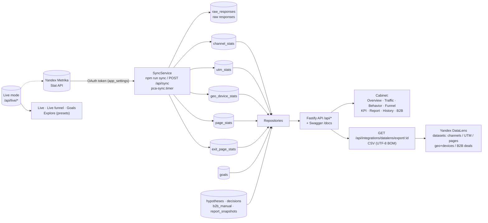
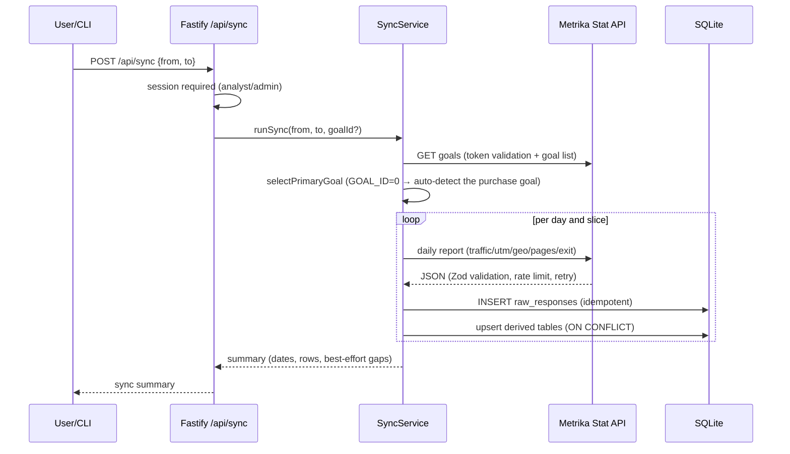
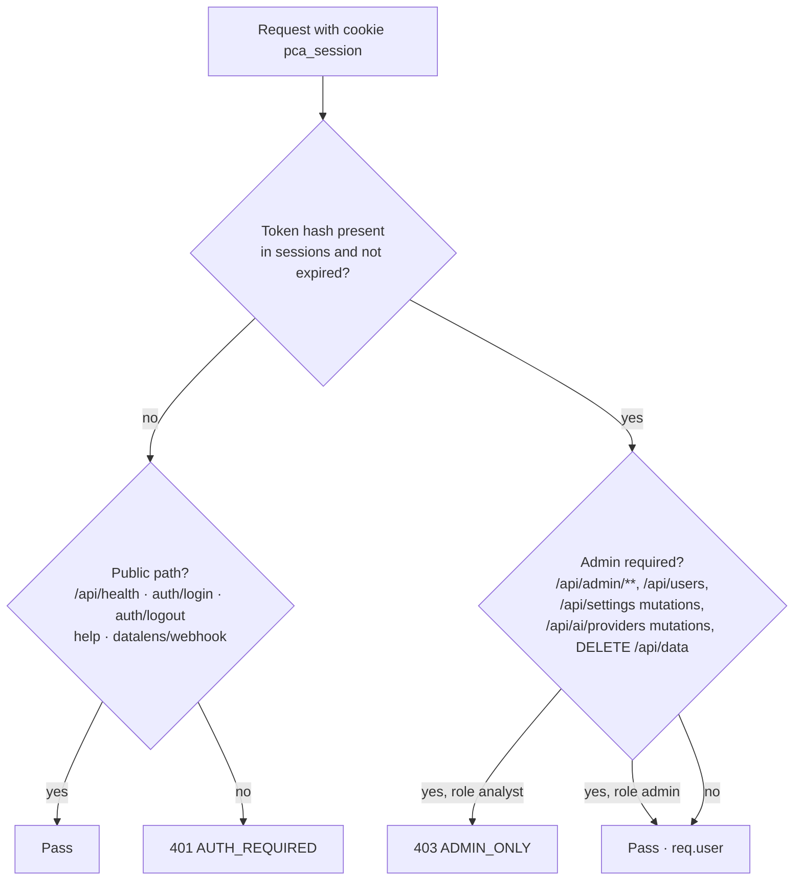
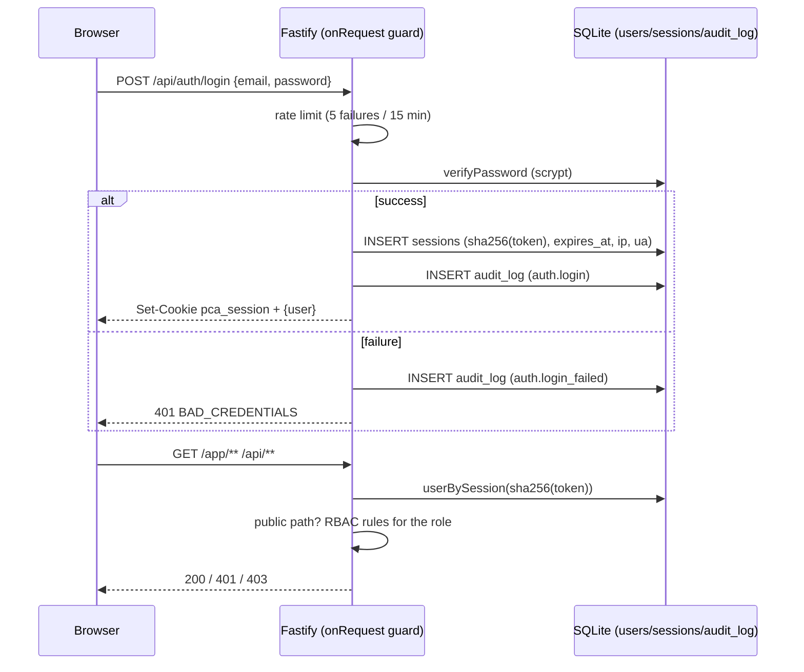

# Architecture

> 🇬🇧 English · [🇷🇺 Русский](../architecture.md). An overview; details live in the ADRs
> (`docs/decisions/`) and in the code.

v3 is a multi-user **web cabinet** on top of the analytics tool: it pulls Yandex Metrika →
SQLite → API → cabinet (roles, audit) + DataLens + AI providers. The public part (landing page,
sign-in, help center) needs no session; everything under `/app` requires signing in.

**Current version:** v3.4.0 (2026-11-05) · **Live site:** <https://dashboardcamp.ru>

## Components

```mermaid
flowchart TD
  subgraph Client [Browser]
    PUB[Public pages<br/>Landing · Sign-in · Help /help]
    CAB[Cabinet /app<br/>React 18 + Vite + Tailwind + ECharts]
    ADM[Administration<br/>Users · AI · Metrika · Integrations · Audit]
    ASST[RAG assistant<br/>floating button]
  end

  subgraph Backend [Backend · Fastify 4 + tsx]
    GUARD["Session guard (onRequest)<br/>cookie pca_session · RBAC admin/analyst"]
    AUTH[auth/<br/>login · logout · me · users · audit]
    SET[settings/<br/>app_settings · runtime settings]
    LLM[llm/<br/>providers · priorities · usage]
    LIVE[live/<br/>real time via the Reporting API]
    HELP[help/<br/>docs/help articles + /help/ask]
    DL[integrations/datalens<br/>CSV export · API check · webhook]
    CORE[routes/ + db/repositories<br/>metrics · hypotheses · B2B · reports]
    SYNC[metrika/sync-service<br/>daily chunks · Zod · retry]
    GOALS[metrika/goals-management<br/>Management API: create/archive/restore]
    SNAP[report/<br/>SnapshotBuilder → DOCX/PDF + AI]
  end

  subgraph Store [SQLite · better-sqlite3]
    METRIC[("Daily metrics:<br/>channel/utm/geo/page/exit + raw_responses")]
    METH[("Methodology:<br/>hypotheses · decisions · b2b_manual · snapshots")]
    CABDB[("Cabinet:<br/>users · sessions · audit_log")]
    CFG[("Settings & AI:<br/>app_settings · ai_providers · ai_usage")]
    EVT[("Events:<br/>datalens_events · notifications")]
  end

  YM[Yandex Metrika API]

  PUB -- REST --> GUARD
  CAB -- "/api/** (fetch)" --> GUARD
  ADM -- "/api/admin/**" --> GUARD
  ASST -- "POST /api/help/ask" --> GUARD
  GUARD --> AUTH & SET & LLM & LIVE & HELP & DL & CORE & GOALS
  AUTH --> CABDB
  SET --> CFG
  LLM --> CFG
  LIVE -. direct requests, no DB writes .-> YM
  GOALS -. metrika:write .-> YM
  HELP --- DOCS[("docs/help/ru · en/*.md")]
  DL --> EVT
  CORE --> METRIC & METH
  SYNC --> YM --> METRIC
  SNAP --> METH
  SNAP -. via the LLM chain .-> LLM
  LLM -.-> PROV[External AI:<br/>OpenRouter / Anthropic / YandexGPT / GigaChat]
  DL --> EXT[Yandex DataLens<br/>Files connection (CSV) · Public API]
```

## Data flow: Metrika → SQLite → API → cabinet / DataLens



Key points:

- **History is daily.** A repeated sync appends dates (`INSERT … ON CONFLICT`) without
  overwriting the past; this enables WoW comparisons and reproducibility. Every number traces back
  to `raw_responses`.
- **Live pages never write to the DB** — `/api/live/*` queries the Reporting API directly with the
  token from `app_settings` (real time for the selected period).
- **DataLens** receives flat CSV datasets (`integrations/datalens.ts`, 5 datasets) through an
  authorized export; the reverse channel is a token-protected webhook receiver (`datalens_events`,
  admin notifications).
- **Scheduled sync.** On the server `pca-sync.timer` runs the sync every 3 hours; admins can also
  trigger it manually from Administration → Metrika & data.

### Synchronization (sequence)



## Authentication and RBAC

- Passwords — **scrypt** (per-user salt, `security/crypto.ts`); only `password_hash` is stored.
- Sessions — cookie `pca_session` (HttpOnly, SameSite=Lax, `Secure` when `COOKIE_SECURE=1`); the
  DB stores only the **sha256 hash** of the token plus expiry, IP and user agent (`sessions`).
- The bootstrap administrator is created on start from `ADMIN_EMAIL`/`ADMIN_PASSWORD` while the
  `users` table is empty; `DEMO_USERS=1` adds demo accounts (admin + analyst).
- Sign-in throttling: 5 failures within 15 minutes per IP+email pair → 429.
- Roles: **Administrator** (everything) and **Analyst** (analytics, reports, B2B, DataLens export —
  no administration). Permissions are enforced on the backend (rules below) and in the UI
  (`RequireAdmin`).





## Cabinet: pages and access

| Section        | Page           | URL                            | Access         |
| -------------- | -------------- | ------------------------------ | -------------- |
| Monitor        | Overview       | `/app`                         | analyst, admin |
|                | Live           | `/app/live`                    | analyst, admin |
|                | Goals + detail | `/app/goals`, `/app/goals/:id` | analyst, admin |
|                | Live funnel    | `/app/funnel-live`             | analyst, admin |
| Analytics      | Traffic        | `/app/traffic`                 | analyst, admin |
|                | Behavior       | `/app/behavior`                | analyst, admin |
|                | Funnel         | `/app/funnel`                  | analyst, admin |
|                | KPI            | `/app/kpi`                     | analyst, admin |
|                | Explore        | `/app/explore/:preset`         | analyst, admin |
| Work           | Report         | `/app/report`                  | analyst, admin |
|                | History        | `/app/history`                 | analyst, admin |
|                | B2B            | `/app/b2b`                     | analyst, admin |
|                | DataLens       | `/app/datalens`                | analyst, admin |
| Administration | Users          | `/app/admin/users`             | **admin**      |
|                | AI providers   | `/app/admin/ai`                | **admin**      |
|                | Metrika        | `/app/admin/metrika`           | **admin**      |
|                | Integrations   | `/app/admin/integrations`      | **admin**      |
|                | Audit          | `/app/admin/audit`             | **admin**      |

Public: `/` (landing), `/login`, `/help` + `/help/:slug` (articles from `docs/help`). Pre-v3 URLs
(`/traffic`, `/report`, `/settings`, …) redirect to `/app/…`, preserving the query string.

## AI layer

- Providers: **OpenRouter · Anthropic · YandexGPT · GigaChat** (`llm/providers.ts`,
  `PROVIDER_META` with models and extra fields: `folderId` for YandexGPT, `scope` for GigaChat).
- Keys are entered under Administration → AI providers, encrypted with **AES-256-GCM** using the
  master key `APP_SECRET`, and stored in `ai_providers.secret_enc` (`iv:tag:ciphertext`, base64).
  Keys in `.env` are only an optional initial seed.
- **Priority chain:** `LlmService.complete` walks the enabled providers in `priority` order; an
  error or timeout falls over to the next one. For compatibility, the legacy Anthropic interface of
  the report is wrapped in `chainAsAnthropicFetch`.
- Every call is recorded in `ai_usage` (provider, model, purpose, size, ms, error) — admins see
  30-day statistics.
- AI consumers: the report (AI analysis, AI hypotheses, AI Decision Log) and the help RAG
  assistant (`POST /api/help/ask` — answers only from chunks of `docs/help/<lang>` articles).
- **GigaChat TLS:** Sber endpoints are signed by the Russian Trusted Root CA, which Node does not
  trust by default. `deploy/deploy.sh` installs the root + sub CA and sets
  `NODE_EXTRA_CA_CERTS=/opt/pca/russian-trusted-ca.pem` in the server `.env`.

## Public integrations

Part of the API is available without a session; protection is rate limiting at two levels: in the
application and in nginx.

**DataLens Public API.** Administration → Integrations → DataLens connection stores
`DATALENS_ORG_ID`, `DATALENS_WORKBOOK_ID` and `DATALENS_IAM_TOKEN` (encrypted) in `app_settings`;
"Check connection" (`POST /api/admin/integrations/datalens/check`, audit `datalens.check`) calls
`https://api.datalens.tech/rpc` with `Authorization: Bearer <IAM>`, `x-dl-org-id` and
`x-dl-api-version`. `scripts/push-datalens.mjs` creates the "ProductCamp Analytics" workbook and a
`metrika_api` connection (counter + OAuth token) from environment variables. An IAM token
(`yc iam create-token`, lives ≤ 12 h) and the `dataLens.editor` role are required. CSV datasets
cannot be uploaded through the Public API (there is no `file` type) — they are connected manually
in the UI: workbook → Connections → Files; sources are served by
`GET /api/integrations/datalens/export/:id`.

**Public endpoints:** `/api/health`, `/api/auth/login|logout`, `/api/help/*` (including
`POST /api/help/ask` — the assistant also answers guests), `/api/integrations/datalens/webhook/*`.

**Rate limits** (`deploy/nginx-ratelimit.conf` → `/etc/nginx/conf.d/pca-ratelimit.conf`; excess →
503, the default `limit_req_status`):

| Level       | What                                    | Limit                                        |
| ----------- | --------------------------------------- | -------------------------------------------- |
| nginx       | `POST /api/auth/login` (zone pca_login) | 10 r/m per IP, burst 5 nodelay               |
| nginx       | other `/api/` (zone pca_api)            | 120 r/m per IP, burst 240 nodelay            |
| application | sign-in (IP+email pair)                 | 5 failures in 15 minutes → 429               |
| application | assistant `/api/help/ask`               | guest 5 / user 20 questions per 10 min → 429 |
| application | analyst DataLens request                | 3 per hour per user → 429                    |

## Operations

- **Deployment:** Ubuntu + nginx + systemd (`pca-api.service`) + certbot — [deploy.md](../deploy.md)
  and `deploy/DEPLOY.md` (RU).
- **Backups:** `pca-backup.timer` (daily 04:30) runs `deploy/backup.sh` — `sqlite3 .backup` →
  gzip, 14 copies; `scripts/pull-backup.sh` copies the latest backup off-site.
- **Monitoring:** `pca-monitor.timer` (every 5 min) checks `/api/health` and restarts the API after
  3 consecutive failures.

## Layers

| Layer          | Where                                   | Technologies                                                                    |
| -------------- | --------------------------------------- | ------------------------------------------------------------------------------- |
| Client         | `code/frontend/src/`                    | React 18, Vite, Tailwind, ECharts, TanStack, Zustand, RU/EN i18n                |
| Authentication | `code/backend/src/auth/` + `security/`  | cookie sessions, scrypt, sha256, rate limiter, audit                            |
| Settings       | `code/backend/src/settings/`            | `app_settings`, AES-256-GCM (`APP_SECRET`), runtime `.env` override, no restart |
| Extraction     | `code/backend/src/metrika/`             | undici fetch, Zod, token bucket, retry, daily chunks, goal management           |
| Live           | `code/backend/src/live/`                | direct Reporting API requests (no DB writes)                                    |
| Storage        | `code/backend/src/db/`                  | better-sqlite3, WAL + FK, migrations 001..011, repositories                     |
| AI             | `code/backend/src/llm/`                 | 4 providers, priority chain, `ai_usage`                                         |
| Help           | `code/backend/src/help/` + `docs/help/` | markdown + front matter, RAG chunk search, `/help/ask`                          |
| Integrations   | `code/backend/src/integrations/`        | DataLens CSV export, Public API check, webhook receiver                         |
| Reports        | `code/backend/src/report/`              | SnapshotBuilder → DOCX (`docx`) / PDF (Puppeteer) + AI; server-side ECharts     |
| API            | `code/backend/src/app.ts`, `routes/`    | Fastify 4, Zod, Swagger `/docs`                                                 |

## Key decisions

- SQLite without Docker; daily history (`decisions/002`, `007`).
- ICE is a product (`decisions/005`); PDF via Puppeteer (`decisions/003`); B2B is manual entry
  (`decisions/004`).
- Sessions — a server-side `sessions` table storing only the token hash; HttpOnly cookie.
- Secrets (Metrika tokens, AI keys, DataLens IAM token) are stored only encrypted in the DB;
  `.env` is a seed for the first start. `APP_SECRET` is mandatory on a server (see `docs/deploy.md`).
- Live pages are not cached in SQLite — real time at the cost of a direct Metrika request.
- The cabinet footer version is `__APP_VERSION__` from the root `package.json` + a short git SHA
  (`vite.config.ts`), duplicated in `/api/health`.

See also: [data-model.md](data-model.md) · [admin-guide.md](admin-guide.md) ·
[user-guide.md](user-guide.md) · [runbook.md](runbook.md).
